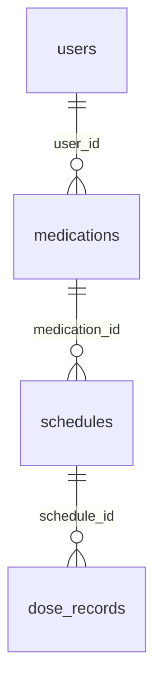

# MediCheck DB 설계 문서

| | |
|---|---|
| 작성자 | 전수환 (Database & Authentication) |
| 작성일 | 2026-11-05 |
| 상태 | **초안 — 팀 검토 중** (이 문서의 PR이 머지되면 확정) |
| 관련 결정 | Issue #3 (인증 방식: Room 기반 로컬 인증) |

이 문서는 세 개발자(DB·일정/알림·UI)가 **같은 데이터 구조를 기준으로 개발하기 위한 약속**입니다.
변경이 필요하면 이 문서를 수정하는 PR을 올려 팀 합의 후 반영합니다.

---

## ① 설계 목적

- 사용자별 약 정보 · 복약 일정 · 복용 기록을 **폰 내부 Room DB** 하나에 저장한다.
- 계정(아이디·비밀번호 해시)도 같은 DB에 둔다. 외부 인증 서버는 사용하지 않는다.
- **복약 이력은 지워지지 않는다.** 약이나 일정을 삭제해도 과거 기록과 통계는 유지된다.
- "반복 규칙"과 "날짜별 실제 복용 건"을 분리해, 매일 반복되는 약도 날짜별 이력을 남길 수 있게 한다.

---

## ② 전체 관계도

```
users (사용자)
  │ 1
  │
  │ N
medications (약)                       ← "누구의 약인지"  user_id
  │ 1
  │
  │ N
schedules (반복 복약 규칙)              ← "어느 약의 규칙인지"  medication_id
  │ 1                                    예) 매일 08:00 / 월·수·금 20:00
  │
  │ N
dose_records (날짜별 복용 기록)          ← "어느 규칙의 어느 날 기록인지"  schedule_id + date
                                         예) 2026-11-05 08:00 → TAKEN
```



한 사용자는 여러 약을, 한 약은 여러 복용 시간(규칙)을, 한 규칙은 날짜마다 하나의 기록을 가진다.

---

## ③ users — 사용자

| 열 | 타입 (Room) | 제약 | 설명 |
|---|---|---|---|
| id | Long | PK, 자동 증가 | 사용자 번호 |
| username | String | UNIQUE, NOT NULL | 로그인 아이디 |
| password_hash | String | NOT NULL | 비밀번호 해시. **평문 저장 금지** |
| display_name | String | NOT NULL | 화면 표시 이름 |
| created_at | Long | NOT NULL | 가입 시각 (epoch millis) |

- 개인정보는 최소한으로 둔다. 생년월일·성별·보호자 연락처·주소는 **넣지 않는다.**
- 해시 알고리즘(SHA-256 + salt 등)은 구현 시 확정한다.

---

## ④ medications — 약

| 열 | 타입 (Room) | 제약 | 설명 |
|---|---|---|---|
| id | Long | PK, 자동 증가 | 약 번호 |
| user_id | Long | FK → users.id, NOT NULL, INDEX | 이 약의 주인 |
| name | String | NOT NULL | 약 이름 (예: 타이레놀) |
| dosage | String | NOT NULL | 복용량. 문자 그대로 저장 (예: "1정", "5ml") |
| start_date | String "YYYY-MM-DD" | NOT NULL | 복용 시작일 |
| end_date | String "YYYY-MM-DD" | NULL 허용 | 복용 종료일. NULL = 종료일 없음 |
| memo | String | NULL 허용 | 메모 (예: 식후 30분) |
| created_at | Long | NOT NULL | 등록 시각 |
| deleted_at | Long | NULL 허용 | **Soft delete.** NULL = 사용 중, 값 있음 = 삭제됨 |

- 복용 **시간**과 **반복 요일**은 이 테이블에 없다. 약 하나에 시간이 여러 개일 수 있으므로 `schedules`에 한 행씩 둔다.
- 복용량 합산 통계는 요구사항에 없으므로 `dosage`는 숫자로 나누지 않는다.

---

## ⑤ schedules — 반복 복약 규칙

**"매일 08:00", "월·수·금 20:00" 같은 반복 규칙**을 저장한다. 날짜별 복용 예정 건은 여기에 두지 않는다 (→ `dose_records`).

| 열 | 타입 (Room) | 제약 | 설명 |
|---|---|---|---|
| id | Long | PK, 자동 증가 | 규칙 번호 |
| medication_id | Long | FK → medications.id, NOT NULL, INDEX | 어느 약의 규칙인지 |
| time | String "HH:mm" | NOT NULL | 복용 시간 (24시간제) |
| repeat_days | String | NOT NULL | 반복 요일. `MON,TUE,WED,THU,FRI,SAT,SUN` 중 쉼표 구분. 매일 = 7개 전부 |
| created_at | Long | NOT NULL | 등록 시각 |
| deleted_at | Long | NULL 허용 | **Soft delete** |

예) 타이레놀(id=1)을 "매일 08:00 + 월·수·금 20:00"으로 등록하면:

| id | medication_id | time | repeat_days |
|---|---|---|---|
| 1 | 1 | 08:00 | MON,TUE,WED,THU,FRI,SAT,SUN |
| 2 | 1 | 20:00 | MON,WED,FRI |

- 시간·요일 변경은 **이 행을 직접 수정**한다. 과거 기록은 `dose_records.scheduled_time`에 당시 시간이 복사되어 있어 영향받지 않는다.
- 변경·삭제 **전에** 반드시 ⑨의 기록 보충을 먼저 실행한다.

---

## ⑥ dose_records — 날짜별 복용 기록

**"2026-11-05 08:00 타이레놀 → 복용 완료"** 같은 실제 건 하나가 한 행이다.

| 열 | 타입 (Room) | 제약 | 설명 |
|---|---|---|---|
| id | Long | PK, 자동 증가 | 기록 번호 |
| schedule_id | Long | FK → schedules.id, NOT NULL, INDEX | 어느 규칙의 기록인지 |
| date | String "YYYY-MM-DD" | NOT NULL | 복용 예정 날짜 |
| scheduled_time | String "HH:mm" | NOT NULL | **기록 생성 당시의** 예정 시간 (규칙이 바뀌어도 유지) |
| status | String | NOT NULL | `PENDING` / `TAKEN` / `SKIPPED` (⑩ 참조) |
| acted_at | Long | NULL 허용 | 사용자가 TAKEN/SKIPPED 버튼을 누른 실제 시각 |
| created_at | Long | NOT NULL | 기록 생성 시각 |

- `UNIQUE(schedule_id, date)` — 같은 규칙·같은 날 기록은 하나만. 앱을 여러 번 열어도 중복 생성되지 않는다.
- 사용자가 이 테이블의 행을 직접 삭제하는 기능은 없다.

---

## ⑦ 제약조건 요약

| 종류 | 내용 |
|---|---|
| PK | 모든 테이블 `id` (자동 증가) |
| FK | medications.user_id → users.id |
| FK | schedules.medication_id → medications.id |
| FK | dose_records.schedule_id → schedules.id |
| UNIQUE | users.username |
| UNIQUE | dose_records (schedule_id, date) |
| INDEX | 모든 FK 열 (Room 권장) |
| FK ON DELETE | 전부 `CASCADE` — 실제로 물리 삭제가 일어나는 건 **계정 삭제** 때뿐 (⑧) |

---

## ⑧ 삭제 정책

**원칙: 이력에 연결된 데이터는 지우지 않고 숨긴다.**

| 테이블 | 방식 | 동작 |
|---|---|---|
| users | Hard delete | 계정 탈퇴. 그 사용자의 약·규칙·기록 전부 CASCADE 삭제 |
| medications | Soft delete (`deleted_at`) | 약 목록에서 숨김. 그 약의 규칙도 함께 soft delete. 새 기록 생성 중단. 알림 취소. 과거 기록 유지 |
| schedules | Soft delete (`deleted_at`) | 일정 목록에서 숨김. 새 기록 생성 중단. 해당 알림 취소. 과거 기록 유지 |
| dose_records | 직접 삭제 없음 | 계정 삭제 시에만 CASCADE |

구현 규칙:
- 약·규칙 조회 쿼리는 기본적으로 `deleted_at IS NULL` 조건을 붙인다.
- 통계·이력 조회는 삭제된 약·규칙의 기록도 **포함**한다 (이름 표시는 soft delete된 행에서 가져온다).
- **삭제 직전에 ⑨ 기록 보충을 먼저 실행**한 뒤 `deleted_at`을 기록한다.
- 의료진 지시로 복용을 중단하는 경우는 삭제가 아니라 `end_date` 수정으로 처리한다.

---

## ⑨ 복용 기록 생성 및 보충 규칙

`dose_records` 행은 사용자가 버튼을 누를 때가 아니라 **시스템이 미리 만든다.**

**언제 실행하나**
1. 앱 실행 시 (홈 화면 진입)
2. 규칙(schedules)의 시간·요일을 변경하기 직전
3. 규칙 또는 약을 삭제하기 직전
4. 약의 `end_date`를 변경하기 직전

**무엇을 만드나** — `deleted_at IS NULL`인 모든 규칙에 대해:
- 대상 날짜 범위: `max(약.start_date, 마지막 생성일 + 1일)` ~ **오늘** (단, `end_date`가 있으면 그 이하)
- 그중 요일이 `repeat_days`에 포함되는 날짜마다 행 1개
- `status = PENDING`, `scheduled_time = 규칙의 현재 time`
- 이미 있는 (schedule_id, date)는 건너뜀 (UNIQUE 제약으로 보장 — `INSERT OR IGNORE`)
- **미래 날짜는 만들지 않는다.** 오늘 치는 시간이 이미 지났더라도 만든다 (→ MISSED로 계산됨)

**왜 과거까지 채우나** — 앱을 11/1~11/4 동안 안 열고 11/5에 열었을 때, 오늘 치만 만들면 1~4일의 누락이 통계에서 사라진다. 비어 있는 과거 날짜를 채워야 "깜빡함"이 정확히 집계된다.

**알려진 한계** — 보충 생성 시 `scheduled_time`은 규칙의 *현재* 시간을 쓴다. 안 연 기간 중에 시간을 바꿨다면 그 기간 기록의 예정 시간은 바뀐 값이 된다. 변경 직전에 보충을 먼저 실행하는 규칙(위 2번)으로 이 경우를 최소화한다.

---

## ⑩ 복용 상태 및 완료율 계산 기준

**저장되는 상태 (3개)**

| status | 뜻 | 누가 만드나 |
|---|---|---|
| PENDING | 예정. 아직 응답 없음 | ⑨ 생성 시 기본값 |
| TAKEN | 복용 완료 | 사용자 버튼 |
| SKIPPED | 규칙은 유지한 채 **의도적으로** 건너뜀 | 사용자 버튼 |

**계산되는 상태 (저장하지 않음)**

| 표시 | 조건 |
|---|---|
| MISSED (깜빡함) | `status = PENDING` 이고 `date + scheduled_time < 현재 시각` |
| 예정 | `status = PENDING` 이고 아직 시간 전 |

MISSED를 저장하지 않으므로 "시간 지났으니 상태를 바꿔라"는 백그라운드 작업이 필요 없다.

**상태 변경 규칙**
- PENDING → TAKEN / SKIPPED: 버튼. `acted_at = 지금`
- TAKEN ↔ SKIPPED: 실수 수정 허용. `acted_at` 갱신
- MISSED 상태(= 시간 지난 PENDING)에서도 TAKEN 가능 ("늦게 먹음"). `acted_at`과 `scheduled_time`의 차이로 지연 복용 분석 가능

**완료율**

```
완료율(%) = TAKEN ÷ (TAKEN + SKIPPED + MISSED) × 100
```
- 분모 = "먹었어야 할 횟수". 아직 시간이 안 된 PENDING(예정)은 제외
- 분모가 0이면 "기록 없음"으로 표시
- SKIPPED는 분모에 포함한다 (처방대로 복용한 비율이 완료율의 뜻). 대신 화면에서는 **완료율 / 깜빡한 횟수(MISSED) / 건너뛴 횟수(SKIPPED)** 세 가지를 따로 보여준다
- "누락 패턴 분석"(추가 기능)의 대상은 MISSED만
- 주간 통계의 한 주는 **월요일 시작 ~ 일요일 끝**
- 삭제된 약·규칙의 기록도 통계에 포함

---

## 구현 시 확인 목록 (Room Entity 작성 전)

- [ ] FK 열에 `@Index` 선언
- [ ] `@Entity(indices = [Index(value = ["schedule_id","date"], unique = true)])`
- [ ] `repeat_days` String ↔ List 변환 (TypeConverter 또는 split)
- [ ] 모든 약·규칙 조회 DAO에 `deleted_at IS NULL`
- [ ] 기록 보충 함수는 Repository 한 곳에만 두고, 앱 실행·변경·삭제 전에 호출
