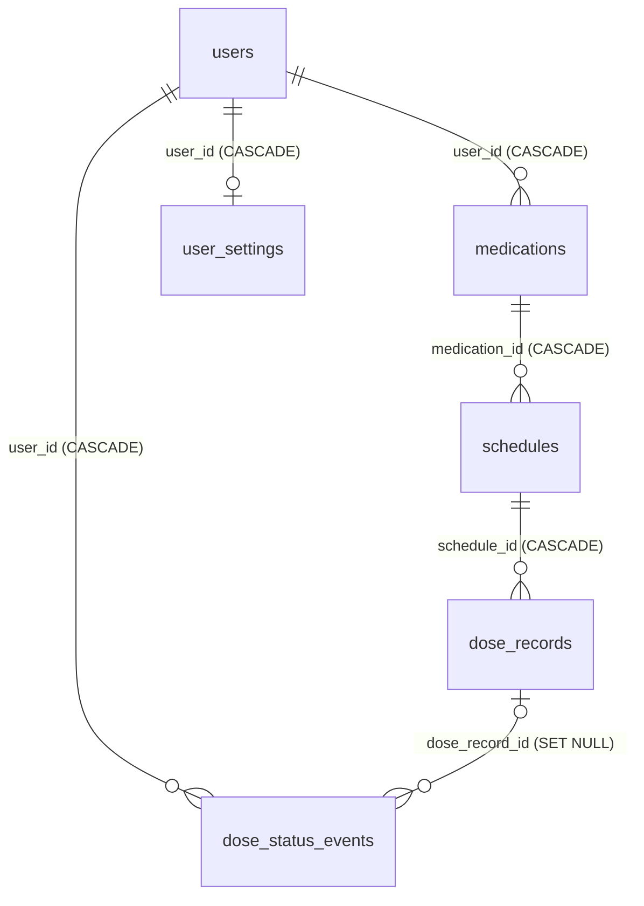

# MediCheck DB 설계 문서 (v3 프로토타입 47개 화면 기준)

| | |
|---|---|
| 작성자 | 전수환 (Database & Authentication) |
| 작성일 | 2026-11-05 (4개 표 초판) → **2026-11-17 개정** (v3 프로토타입 47개 화면 기준, Room version 5) |
| 상태 | **개정판 — 1단계 PR(Issue #22)에서 코드와 함께 반영** |
| 근거 | 구현 명세 `00_공통`~`07`, DB 개정안 `08_DB_설계_개정안.md`, 2026-11-17 전수환 결정 1~9 |
| 관련 결정 | Issue #3 (인증 방식: Room 기반 로컬 인증) |

이 문서는 화면을 만드는 사람과 DB·로직을 만드는 사람이 **같은 데이터 구조를 기준으로 개발하기 위한 약속**이다. 코드는 이 문서를 따른다. 구조를 바꾸려면 이 문서를 먼저 고친다.

**2026-11-17 전수환 결정 (본문에 녹여 넣음)**
1. DB 변경은 1단계 첫 PR에서 한 번에 넣는다 (Room version 5). → 부록 F
2. 접근성 설정(글자 크기·높은 대비·움직임 줄이기)은 **폰 단위**(`AppPrefs`)에 둔다. → 부록 A
3. 계정·데이터 삭제(S44)는 **지금 계정만** 지운다. 다른 계정은 남는다. 지운 뒤 S00으로 간다. → ⑧-3
4. 백업 복원(S28)은 **다른 계정의 백업 파일이면 막는다**. → 부록 B
5. 삭제한 약의 지난 기록도 회차 상세(S10)에서 상태를 고칠 수 있다('삭제된 약' 표시). → ⑩ 10.3
6. 샘플 계정의 약 시작일은 **32일 전**, 기록은 32일 전~오늘. 끝난 약은 더하지 않는다. → 부록 D
7. Room의 외래 키 검사와 `clearAllTables` 동작은 1단계에서 확인한다. → ⑦ (확인 결과 적음)
8. 시간대 정책(S35)에서 '등록한 시간대 기준'을 고르면 **그 순간 폰의 시간대**를 `home_zone_id`로 저장한다. → ⑥-3, 10.7
9. 파일 간 이름(알림 extra, 자산 칸, 접근성 키)은 맞춰졌음을 확인했다. → 부록 A-2, E

**처음 보는 말 (이 문서 전체에서 쓰는 것)**
- 표(table)·칸(column)·줄(row): DB 안의 엑셀 시트 하나, 그 열 하나, 그 행 하나.
- PK(Primary Key, 기본 키): 줄 하나를 가리키는 번호. FK(Foreign Key, 외래 키): 다른 표의 줄을 가리키는 칸.
- CASCADE: 가리키던 줄이 지워지면 이 줄도 함께 지워짐. SET NULL: 가리키던 줄이 지워지면 이 칸만 비움(NULL).
- Soft delete(숨김 삭제): 줄을 지우지 않고 `deleted_at`에 지운 시각만 적어 숨기는 방식. Hard delete(물리 삭제): 줄을 실제로 지움.
- 스냅샷(snapshot): 그때의 값을 복사해 찍어 둔 사본. 원본이 바뀌어도 사본은 그대로다.
- 트랜잭션(transaction): 여러 DB 작업을 한 묶음으로. 하나라도 실패하면 전부 없던 일이 된다.
- epoch millis: 1970-01-01 0시(UTC)부터 지난 밀리초. 시각을 숫자 하나로 적는 방법.
## 바뀐 점 한눈에 (현재 → 개정)

| # | 대상 | 현재 | 개정 | 이유 | 관련 화면 |
|---|---|---|---|---|---|
| 1 | `users.username` | 아이디(영문 소문자·숫자·밑줄 4~20자)로 로그인 | **없앰.** `email`(소문자로 다듬어 저장, UNIQUE)로 로그인 | 결정 3 (이메일 + 비밀번호 6자 이상) | S01, S02, S03, S19, S21, S28 |
| 2 | `users.is_sample` | 없음 | **NEW** 샘플 계정 표시 (0/1) | 샘플 계정 찾기·다시 만들기, 샘플 이메일 예약 (01 S01-2) | S01, S02, S06, S21, S32 |
| 3 | 비밀번호 길이 | 8자 이상 | **6자 이상** (DB에는 해시만 있으므로 검사는 코드) | 결정 3 | S01, S02 |
| 4 | `medications.paused_from` | 없음 (일시중지 없음) | **NEW** 일시중지 시작일 | 결정 7 "일시중지 기간에는 기록을 만들지 않음" | S06, S07 |
| 5 | `medications.hospital`·`department`·`source_memo` | 없음 | **NEW** 처방 의료기관·진료과·처방 출처 메모 | F093 | S42, S07 |
| 6 | `schedules.effective_from` | 없음 | **NEW** 이 규칙이 회차를 만들기 시작하는 날 | 결정 7 "내일부터 적용"은 적용 시작일로 구현, 지난 날짜 소급 생성 버그 수정 | S33, S07, S08 |
| 7 | `dose_records` 스냅샷 | 예정 시각(`scheduled_time`)만 복사 | **NEW** `medication_name`·`dosage`·`memo`도 기록을 만들 때 복사 | 결정 7 (F070). 약 이름을 고치거나 약을 지워도 지난 회차는 그때 값 | S04, S05, S10, S12, S16, S32, S43 |
| 8 | `dose_records.acted_at` | 버튼을 누른 시각 | 뜻을 넓힘: 복용 완료면 **실제 복용 시각**(S31에서 고칠 수 있음), 건너뜀이면 누른 시각, 미기록이면 NULL | 사전 준비 6.5, F073 | S10, S31, S43 |
| 9 | 상태 변경 이력 | 없음 (덮어쓰기만) | **NEW 표 `dose_status_events`** | F072, 실행취소(결정 7) | S30, S10, S04, S05 |
| 10 | 사용자 설정 | 없음 | **NEW 표 `user_settings`** (계정마다 한 줄) + 기기 설정 `AppPrefs`(SharedPreferences) | 설정 토글이 실제로 동작 (결정 7) | S17, S35, S36, S37, S41, S00 |
| 11 | 삭제 정책 | 물리 삭제는 계정 삭제 때뿐 | 물리 삭제가 일어나는 곳: **S44 지금 계정 삭제**, **S28 복원(덮어쓰기)**, **샘플 계정 다시 만들기**, 오늘 치 다시 맞추기 | 2026-11-17 결정 3 (S44는 지금 계정만) | S44, S28, S01 |
| 12 | 기록 생성 범위 | `max(시작일, 마지막 생성일+1)` ~ `min(오늘, 종료일)` | 시작에 `effective_from`, 끝에 `paused_from − 1일`을 더함 | 결정 7 | 전체 |
| 13 | 표시 상태 이름 | 예정 / 깜빡함(MISSED) | `'○ 복용 예정'` / `'! 기한 경과 · 미기록'` (v3 문구). 정각부터 기한 경과 | 결정 5 | 전체 |
| 14 | 완료율 | 완료 ÷ (완료+건너뜀+깜빡함), 시각 전 PENDING 제외. **미리 누른 완료는 셈** | 완료 ÷ **도래한 회차**. 시각 전 회차는 상태와 관계없이 뺌. 분모 0이면 `'N/A'` | 결정 6 | S04, S11~S15, S20 |
| 15 | 주간 통계 | 월요일~일요일 한 주 | **오늘 포함 최근 7일** | 결정 6 | S13, S20 |
| 16 | 패턴 분석 | 대상 = 깜빡함 | **건너뜀**을 시간대 4구간으로 + 기한 경과 미기록은 따로 숫자 | 결정 6 | S15 |
| 17 | `AppDatabase.version` | 3 (저장소 main), 4 (1단계 작업 중간) | **5** (적용함) | 표 구조 변경 | — |

---

## ① 설계 목적

- 사용자별 약 정보 · 복약 규칙 · 날짜별 복용 기록 · 상태 변경 이력 · 사용자 설정을 **폰 내부 Room DB** 하나에 저장한다. (Room: 안드로이드가 주는 SQLite DB 도구. 표를 Kotlin 클래스로 정의한다.)
- 계정(이메일·비밀번호 해시)도 같은 DB에 둔다. 외부 인증 서버는 쓰지 않는다(Issue #3). 인터넷이 없어도 모든 기능이 동작한다(S38).
- **응답한 복약 기록과 지난 날짜의 기록은 지워지지 않는다.** 약이나 규칙을 수정·삭제해도 그때의 약 이름·복용량·메모·예정 시각(스냅샷)과 함께 남는다(결정 7).
- **기록이 어떻게 바뀌었는지 남긴다.** 상태를 바꿀 때마다 이력 한 줄을 쓰고, 실행취소는 그 이력으로 한다.
- "반복 규칙"(schedules)과 "날짜별 실제 회차"(dose_records)를 분리한다. 지난 날짜·오늘은 기록 줄이 기준이고, 내일 이후는 규칙에서 계산만 한다(저장하지 않음).
- 기기 단위 설정(글자 크기·온보딩 등)은 DB가 아니라 SharedPreferences에 둔다(부록 A).

---

## ② 전체 관계도

```
users (사용자)
  │ 1 ─────────────────────────────┬──────────────────────────────┐
  │ N                              │ 1 (user_id가 PK)              │ N
medications (약)                user_settings (계정별 설정)     dose_status_events (상태 변경 이력)
  │ 1                                                              ▲ N
  │ N                                                              │ (dose_record_id, SET NULL)
schedules (반복 복약 규칙)                                           │ 0..1
  │ 1                                                              │
  │ N                                                              │
dose_records (날짜별 복용 기록, 스냅샷 포함) ─────────────────────────┘
```



- 한 사용자는 여러 약을, 한 약은 여러 복용 시간(규칙)을, 한 규칙은 날짜마다 하나의 기록을 가진다.
- 한 기록은 여러 이력 줄을 가진다. 이력 줄은 기록이 지워져도 남는다(`dose_record_id`만 NULL). 그래서 이력 줄은 **사용자를 직접 가리킨다**(`user_id`).
- 한 사용자는 설정 한 줄을 가진다(없으면 기본값으로 본다).
- DB 밖 저장소(로그인 사용자 id, 기기 설정, 화면 선택 상태, 107개 기능 CSV)는 부록 E.

---
## ③ users — 사용자

| 칸 | 타입 (Room / SQLite) | 제약 | 설명 |
|---|---|---|---|
| id | Long / INTEGER | PK, 자동 증가 | 사용자 번호 |
| email | String / TEXT | NOT NULL, **UNIQUE** | 로그인 이메일. **앞뒤 공백을 없애고 소문자로 바꿔 저장·비교**한다 (`Me@Mail.com` = `me@mail.com`) |
| password_hash | String / TEXT | NOT NULL | 비밀번호 해시. **평문 저장 금지** |
| display_name | String / TEXT | NOT NULL | 화면 표시 이름. 앞뒤 공백 제거 후 1~30자 |
| created_at | Long / INTEGER | NOT NULL | 가입 시각 (epoch millis). 샘플 계정은 "오늘 만든 샘플인지" 판단에도 씀 |
| is_sample | Boolean / INTEGER 0·1 | NOT NULL, DEFAULT 0 | **NEW** 샘플 계정이면 1 |

- `username` 칸은 **없앤다**(이메일로 대체).
- 이메일 형식: `^[^@\s]+@[^@\s]+\.[^@\s]+$` (`domain/AuthValidator.kt`). 실제로 있는 주소인지는 확인하지 않는다.
- 비밀번호: 6자 이상(결정 3). 해시 방식은 지금과 같다 (`domain/PasswordHasher.kt`):
  - PBKDF2-HMAC-SHA256, 반복 100,000회, 결과 256비트, 사용자마다 무작위 salt 16바이트
  - `password_hash` 형식: `pbkdf2$반복횟수$salt$해시` (salt·해시는 Base64)
- **샘플 이메일 `demo@medicheck.app` 예약**: `is_sample = 1`인 계정만 이 이메일을 쓴다. 회원가입(S02)·프로필 수정(S21)에서 이 이메일을 넣으면 "이미 가입된 이메일"(`EMAIL_TAKEN`)로 처리한다. 샘플 계정은 한 번에 하나만 있다(코드가 지킴 — 다시 만들 때 옛 샘플을 먼저 지움, 부록 D).
- 샘플 계정의 비밀번호는 무작위 UUID의 해시라서 로그인 폼으로는 들어갈 수 없다. "샘플 계정으로 체험하기" 버튼으로만 들어간다.
- 개인정보는 최소한으로 둔다. 생년월일·성별·보호자 연락처·주소는 **넣지 않는다**(S23~S27 가족·보호자는 시안 화면이고 입력값을 저장하지 않음 — 결정 11).
- 로그인 상태는 DB가 아니라 SharedPreferences에 로그인한 사용자의 `id`만 저장한다 (부록 E, 지금 `SessionStore` 그대로).
- 이메일·비밀번호 검사 순서(빈칸 → 형식 → 길이)는 `AuthValidator`가 한다. 오류 이름: `EMAIL_EMPTY`·`EMAIL_INVALID`·`PASSWORD_EMPTY`·`PASSWORD_TOO_SHORT`·`PASSWORD_MISMATCH`·`DISPLAY_NAME_INVALID`·`EMAIL_TAKEN`·`WRONG_CREDENTIALS`·`SAMPLE_FAILED`.

---

## ④ medications — 약

| 칸 | 타입 | 제약 | 설명 |
|---|---|---|---|
| id | Long | PK, 자동 증가 | 약 번호 |
| user_id | Long | FK → users.id **CASCADE**, NOT NULL, INDEX | 이 약의 주인 |
| name | String | NOT NULL | 약 이름 (예: 비타민 D) |
| dosage | String | NOT NULL | 복용량. 글자 그대로 (예: "1정", "5ml") |
| start_date | String "YYYY-MM-DD" | NOT NULL | 복용 시작일 |
| end_date | String "YYYY-MM-DD" | NULL 허용 | 복용 종료일. NULL = 종료일 없음. **종료일 < 오늘이면 '종료' 배지(A7)** |
| memo | String | NULL 허용 | 메모 (예: 아침 식후) |
| created_at | Long | NOT NULL | 등록 시각 |
| deleted_at | Long | NULL 허용 | **Soft delete.** NULL = 사용 중, 값 있음 = 삭제됨 |
| paused_from | String "YYYY-MM-DD" | NULL 허용 | **NEW** 일시중지를 시작한 날. NULL = 복용 중. 이날부터 기록·알림을 만들지 않는다 (⑧-2) |
| hospital | String | NULL 허용 | **NEW** 처방 의료기관 (S42) |
| department | String | NULL 허용 | **NEW** 진료과 (S42) |
| source_memo | String | NULL 허용 | **NEW** 처방 출처 메모. `memo`(복용 메모)와 다른 칸. S42에서만 보인다 |

- 복용 **시간**과 **반복 요일**은 이 표에 없다. 약 하나에 시간이 여러 개일 수 있으므로 `schedules`에 한 줄씩 둔다.
- 글자 칸(`memo`·`hospital`·`department`·`source_memo`)은 앞뒤 공백을 없앤 뒤 빈 글자면 **NULL로 저장**한다. 화면·domain에서는 NULL을 `""`로 바꿔 쓴다(03 부록 A-2).
- `paused_from`은 "일시중지 켬"을 누른 **그날**로만 정해진다(미래 날짜로 예약하는 기능 없음). 그래서 "NULL이 아니면 지금 중지 중"이다. 재개하면 NULL로 돌아간다. 지난 중지 기간은 따로 저장하지 않는다 — 그 기간에는 기록 줄이 없는 것 자체가 흔적이다.
- 상태 배지 판정(S06·S07, 03 공통 규칙 3)은 위에서부터 먼저 맞는 것 하나: `end_date < 오늘` → '종료'(A7) / `paused_from` 있음 → '일시중지' / 그 밖 → '복용 중'. 종료일 **당일**은 아직 복용 중. 저장하지 않고 계산한다(`domain/MedicationStatus.kt`).
- 목록 정렬(S06): DB는 `ORDER BY id`(등록 순, v3와 같음)로 주고, "종료된 약은 사용 중인 약 뒤로"(A7)는 domain에서 한다.
- 의료진 지시로 복용을 끝내는 경우는 삭제가 아니라 `end_date` 수정으로 처리한다.

---

## ⑤ schedules — 반복 복약 규칙

"매일 08:00", "월·수·금 20:00" 같은 **반복 규칙**을 저장한다. 날짜별 회차는 여기에 두지 않는다 (→ `dose_records`).

| 칸 | 타입 | 제약 | 설명 |
|---|---|---|---|
| id | Long | PK, 자동 증가 | 규칙 번호 |
| medication_id | Long | FK → medications.id **CASCADE**, NOT NULL, INDEX | 어느 약의 규칙인지 |
| time | String "HH:mm" | NOT NULL | 복용 시간 (24시간제) |
| repeat_days | String | NOT NULL | 반복 요일. `MON,TUE,WED,THU,FRI,SAT,SUN` 중 쉼표 구분, 1개 이상. 매일 = 7개 전부 |
| created_at | Long | NOT NULL | 등록 시각 |
| deleted_at | Long | NULL 허용 | **Soft delete** |
| effective_from | String "YYYY-MM-DD" | NULL 허용 | **NEW** 이 규칙(지금 값)이 회차를 만들기 시작하는 날. NULL = 약의 시작일부터 |

예) 비타민 D(id=1)를 "매일 08:00 + 월·수·금 20:00"으로 등록하면:

| id | medication_id | time | repeat_days | effective_from |
|---|---|---|---|---|
| 1 | 1 | 08:00 | MON,TUE,WED,THU,FRI,SAT,SUN | NULL |
| 2 | 1 | 20:00 | MON,WED,FRI | NULL |

- 요일 글자 ↔ 요일 묶음 변환은 `domain/RepeatDays.kt`의 `encode/decode` 그대로. 화면 표기("매일", "월·수·금", 일요일부터)는 03 공통 규칙 1.
- 폼(S08)은 "시간 여러 개 + 요일 한 묶음"이지만 저장은 지금처럼 **시간마다 한 줄**이고 각 줄에 같은 `repeat_days`를 넣는다. 줄마다 요일이 다른 데이터(예: 백업 복원)도 DB는 받는다(S08 혼합 요일 모드, 03 S08 규칙 6).
- **새 약을 등록할 때**: 모든 규칙 줄의 `effective_from = NULL` (시작일이 지난 약이면 시작일부터 기록을 채운다 — 지금 동작 그대로).
- **약을 수정할 때 — 적용 범위 (S33, F089)**: 적용일 = "오늘 이후 회차에 적용"(`FROM_TODAY`)이면 오늘, "내일부터 적용"(`FROM_TOMORROW`)이면 내일.

**줄 맞추기 규칙 (어느 줄이 "바뀐 줄"인가)**: 폼(S08)은 수정 화면을 열 때 각 시간 줄의 **원래 규칙 id**를 함께 들고 있다. 저장할 때 id가 있는 줄 = 기존 줄(값이 다르면 "바뀐 줄", 같으면 "그대로인 줄"), id가 없는 줄 = "새 줄", 원래 id 중 폼에 없는 것 = "빠진 줄". **시각 글자를 비교해 짝을 짓지 않는다.** (사용자가 08:00 줄을 지우고 20:00 줄을 새로 넣으면 "빠진 줄 + 새 줄"이고, 08:00 줄의 시각을 20:00으로 고치면 "바뀐 줄"이다.)

**줄별 적용 시작일** — `FROM_TOMORROW`면 모두 내일. `FROM_TODAY`면 아래 "오늘 시각 규칙"을 따른다.

| 규칙 줄 | 처리 |
|---|---|
| 시각이나 요일이 바뀐 줄 | **이 줄을 직접 고치고** `effective_from = 그 줄의 적용일` |
| 새로 더한 줄 | `effective_from = 그 줄의 적용일`로 추가 |
| 빠진 줄 | soft delete (`deleted_at`) |
| 그대로인 줄 | 손대지 않음. 단 `FROM_TODAY`이고 `effective_from > 오늘`(같은 날 앞서 "내일부터"로 바꾼 줄)이면 `effective_from = 오늘`로 내린다 |

- **오늘 시각 규칙 (`FROM_TODAY`의 바뀐 줄·새 줄)**: 그 줄의 새 시각이 **지금보다 뒤**면 적용일 = 오늘, 아니면(이미 지난 시각) 적용일 = **내일**. 그래서 저장하자마자 '! 기한 경과 · 미기록'이 되는 회차는 생기지 않는다(받은 적 없는 회차가 완료율 분모에 들어가지 않게, 결정 6 "도래한 회차"의 뜻). 예: 10시에 20:00 → 08:00으로 고치면 그 줄은 내일부터 08:00이고, 오늘 남아 있던 20:00 미기록(시각 전)은 ⑧ "오늘 치 다시 맞추기"로 지워진다 → 오늘 이 줄의 회차는 없다.
- **같은 줄에 오늘 기록이 이미 있으면** (응답했거나 시각이 지난 미기록): 그 기록은 그대로 남고, 같은 (규칙, 오늘)이라 새 시각 회차는 오늘 생기지 않는다(`UNIQUE(schedule_id, date)`). **받아들이는 한계** — 오늘은 그 줄의 회차를 이미 받은 것으로 본다. 예: 10시에 08:00 줄(오늘 기한 경과)을 20:00으로 고치면 오늘은 08:00 기록 하나뿐, 내일부터 20:00.
- **알려진 한계 (빠진 줄 + 새 줄)**: 오늘 이미 응답한 08:00 줄을 지우고 21:00 새 줄을 넣으면 새 id라서 오늘 21:00 회차도 생긴다(오늘만 2회). 사용자가 "시간을 하나 더 넣은" 것과 구별할 수 없으므로 그대로 둔다(03 열린 질문 S33-3과 같은 한계). 화면 문구로 막지 않는다.
- **재개할 때**(일시중지 끄기): 이 약의 사용 중인 규칙마다 `effective_from = max(지금 값, 오늘)` — 중지 기간 날짜를 다시 채우지 않게 (`ScheduleDao.raiseEffectiveFrom(userId, medId, 오늘)`).
- **NEW 종료일을 늘릴 때 (끝난 약 다시 쓰기)**: 옛 `end_date < 오늘`이고 새 `end_date`가 옛 값보다 뒤(또는 NULL)이면, 이 약의 사용 중인 규칙마다 `effective_from = max(지금 값, 적용일)` (재개와 **같은 함수** `raiseEffectiveFrom`). 그러지 않으면 생성기가 "마지막 기록일 + 1일"부터 오늘까지를 채워, 끝나 있던 기간이 모두 '! 기한 경과 · 미기록'이 된다(⑧-2에서 고친 "중지 기간이 기한 경과로 잡힘"과 같은 종류). 이 경우 "오늘 시각 규칙"도 함께 적용한다(지난 시각 줄은 내일부터).
- **NEW 종료일을 오늘보다 앞으로 당길 때**: ⑧ "종료일 당김 정리"를 따른다.
- **시작일을 바꿀 때**: 아직 기록이 없는 약(시작일이 미래였던 약)의 시작일을 과거로 당기면 새 약을 지난 시작일로 등록한 것과 같게 처리한다(9.3 — 시작일부터 채움, 부록 J). 이미 기록이 있는 약의 시작일을 뒤로 미뤄도 지난 기록은 지우지 않는다(응답한 기록 보존 원칙).
- 과거 기록은 `dose_records`의 스냅샷에 그때 값이 들어 있으므로 규칙 줄을 고쳐도 영향받지 않는다.
- 변경·삭제 **전에** 반드시 ⑨의 기록 보충을 먼저 실행한다(지금 규칙 그대로).
- 저장 순서 전체(트랜잭션 1~5, 커밋 뒤 알림)는 03 명세 S33 "저장 순서"를 따르되, 위 "줄 맞추기·오늘 시각 규칙·종료일 늘림/당김"과 ⑧ "오늘 치 다시 맞추기"의 두 갈래를 그 순서에 넣는다.

---

## ⑥ dose_records — 날짜별 복용 기록

"2026-11-16 08:00 비타민 D 1정 → 복용 완료" 같은 실제 회차 하나가 한 줄이다. **오늘과 지난 날짜에만** 있다.

| 칸 | 타입 | 제약 | 설명 |
|---|---|---|---|
| id | Long | PK, 자동 증가 | 기록 번호 |
| schedule_id | Long | FK → schedules.id **CASCADE**, NOT NULL | 어느 규칙의 기록인지 |
| date | String "YYYY-MM-DD" | NOT NULL | 복용 예정 날짜 |
| scheduled_time | String "HH:mm" | NOT NULL | 스냅샷: **기록을 만들 때의** 예정 시각 |
| medication_name | String | NOT NULL | **NEW** 스냅샷: 기록을 만들 때의 약 이름 |
| dosage | String | NOT NULL | **NEW** 스냅샷: 기록을 만들 때의 복용량 |
| memo | String | NULL 허용 | **NEW** 스냅샷: 기록을 만들 때의 약 메모 |
| status | String | NOT NULL | `PENDING`(미기록) / `TAKEN`(복용 완료) / `SKIPPED`(건너뜀) (⑩) |
| acted_at | Long | NULL 허용 | `TAKEN`이면 **실제 복용 시각**(처음엔 누른 시각, S31에서 고칠 수 있음), `SKIPPED`면 누른 시각, `PENDING`이면 NULL |
| created_at | Long | NOT NULL | 기록 생성 시각 |

- `UNIQUE(schedule_id, date)` — 같은 규칙·같은 날 기록은 하나만. 이 두 값이 **회차의 열쇠 `DoseKey(scheduleId, date)`**다. 화면 이동 인자(S10·S31), 알림 Intent, 기록이 아직 없는 미래 회차를 가리킬 때 모두 이 열쇠를 쓴다. (이 UNIQUE 인덱스가 `schedule_id` FK의 인덱스도 겸한다 — 지금과 같음.)
- **스냅샷 4칸(`scheduled_time`·`medication_name`·`dosage`·`memo`)은 기록을 만들 때 한 번 채우고 이후 바꾸지 않는다.** 단 하나의 예외: **오늘·`PENDING`·예정 시각 전**인 기록은 약·규칙을 `FROM_TODAY`로 고칠 때 새 값으로 다시 맞춘다(⑧ "오늘 치 다시 맞추기" (2) — 같은 줄을 UPDATE하므로 id와 이력 연결이 유지된다). 화면(S04·S05·S10·S12·S16·S32)과 CSV(S43)·알림 문구는 지난 날짜·오늘의 약 이름·복용량을 **이 칸에서** 읽는다(medications를 JOIN해서 읽지 않는다). JOIN은 "이 기록이 이 사용자의 것인가"를 확인할 때만 쓴다.
- `user_id` 칸은 두지 않는다. 주인 확인은 지금처럼 `schedules → medications.user_id` JOIN으로 한다(약 줄은 soft delete라 늘 남아 있어 JOIN이 끊기지 않는다).
- **실제 복용 시각을 보이는 조건 (한 곳에서 판정)**: `status = TAKEN`이고 `acted_at`이 있으며, **`acted_at`을 `AppClock.zone`(10.7)으로 바꾼 날짜가 `date`와 같을 때만** "HH:mm". 아니면 보이지 않는다(3일 전 회차를 오늘 복용 완료로 바꾼 경우, 누른 시각이 실제 복용 시각처럼 보이지 않게 — 02 S10 2-5). 이 판정은 domain 함수 하나 `DoseItem.actualTimeOrNull(zone): LocalTime?`에 두고 **S10 2-5·S31 3-4 처음 값·CSV '실제복용시각'(부록 C)이 함께 쓴다.** 샘플 계정의 기록은 `acted_at = NULL`.
- 사용자가 이 표의 줄을 직접 지우는 기능은 없다. 시스템이 지우는 경우는 ⑧에 모두 적었다.
- 내일 이후 날짜의 줄은 만들지 않는다(⑨). 예외: 시간대 변경(S35)으로 "오늘"이 앞으로 당겨지면 이미 만든 오늘 줄이 "미래 날짜 줄"처럼 보일 수 있다 — 지우지 않는다. 이런 줄을 어떻게 보이고 다루는지는 ⑨ 9.5 "기록 줄 우선 합치기 규칙"이 정한다(05 S35 R6).

조회 예 — 기간 조회(`observeRange`)는 스냅샷에서 읽도록 바뀐다:

```sql
SELECT r.id AS id, r.schedule_id AS scheduleId, r.date AS date,
       r.scheduled_time AS scheduledTime, r.status AS status, r.acted_at AS actedAt,
       m.id AS medicationId, r.medication_name AS medicationName,
       r.dosage AS dosage, r.memo AS memo
FROM dose_records r
JOIN schedules s ON s.id = r.schedule_id
JOIN medications m ON m.id = s.medication_id
WHERE m.user_id = :userId AND r.date BETWEEN :fromDate AND :toDate
ORDER BY r.date, r.scheduled_time, r.medication_name COLLATE NOCASE
```

---

## ⑥-2 dose_status_events — 상태 변경 이력 (NEW 표)

기록의 상태나 실제 복용 시각이 바뀔 때마다 한 줄씩 **쓰기만 하는** 표. S30이 이 표만 읽어 그리고(JOIN 없음), S10·A1의 실행취소가 이 표로 되돌린다.

| 칸 | 타입 | 제약 | 설명 |
|---|---|---|---|
| id | Long | PK, 자동 증가 | 이력 번호. 같은 시각이면 이 값으로 순서를 가른다 |
| user_id | Long | FK → users.id **CASCADE**, NOT NULL, INDEX | 누구의 이력인지. 계정을 지우면 함께 지워진다 |
| dose_record_id | Long | NULL 허용, FK → dose_records.id **SET NULL**, INDEX | 바뀐 기록. 기록이 지워지면 NULL이 되고 이력 줄은 남는다 |
| schedule_id | Long | NOT NULL (FK 아님, 값 복사) | 회차 열쇠 복사본. **S30 줄을 누르면 `(schedule_id, dose_date)`로 S10을 연다**(02 ① "S10을 여는 화면 … S30") — 기록이 지워져 `dose_record_id`가 NULL이어도 같은 회차로 이어진다 |
| dose_date | String "YYYY-MM-DD" | NOT NULL | 회차 날짜 복사본 (S30 줄의 날짜) |
| scheduled_time | String "HH:mm" | NOT NULL | 회차 예정 시각 복사본 |
| medication_name | String | NOT NULL | 약 이름 복사본 (기록의 스냅샷 값, S30 줄의 이름) |
| from_status | String | NOT NULL | 바뀌기 전 상태 (`PENDING`/`TAKEN`/`SKIPPED`). 실행취소 때 되돌릴 값 |
| to_status | String | NOT NULL | 바뀐 뒤 상태 |
| from_acted_at | Long | NULL 허용 | 바뀌기 전 `acted_at`. 실행취소 때 실제 복용 시각까지 되돌린다 |
| to_acted_at | Long | NULL 허용 | 바뀐 뒤 `acted_at` |
| changed_at | Long | NOT NULL | 바꾼 시각 (epoch millis). S30 '변경 시각', 최신순 정렬 |
| is_undo | Boolean / INTEGER 0·1 | NOT NULL, DEFAULT 0 | 실행취소로 생긴 줄이면 1 |

- **왜 복사 칸을 두나**: 약을 수정·삭제하면 "오늘·미기록·예정 시각 전" 기록이 지워진다(⑧). 그 기록에 이력이 있었다면(예: A1으로 복용 완료 → 실행취소로 미기록), 이력이 기록을 따라 지워지면 F072("변경 시간·이전값·새값 보관")에 어긋난다. 그래서 이력 줄은 회차·이름을 스스로 들고, 기록과의 연결은 SET NULL로 둔다. (v3의 `auditEvents`도 `name`·`date`를 직접 가진다.)
- 이 표의 줄은 고치거나 지우지 않는다. 지워지는 경우는 계정 삭제(CASCADE)·S28 복원(그 계정 이력 전부)·샘플 다시 만들기(CASCADE)뿐이다(⑧).
- 화면에는 상태를 한국어로 보인다(영어 원시값 금지, 결정 7). 대응은 ⑩의 표.
- 정렬: 화면(S30)·실행취소는 `ORDER BY changed_at DESC, id DESC`. 백업용 `findAllForUser`는 **반대로 `ORDER BY changed_at ASC, id ASC`**(오래된 것부터)로 읽어 그 순서대로 파일에 쓰고, 복원 때 파일 순서대로 넣는다(부록 B) — 같은 `changed_at`인 줄의 앞뒤가 새 id에서도 유지된다.

---

## ⑥-3 user_settings — 계정별 설정 (NEW 표)

계정마다 한 줄. 알림 수신기(앱이 꺼져 있어도 시스템이 깨우는 부분)가 로그인 사용자 id로 바로 읽을 수 있고, 계정을 지우면 함께 지워진다.

| 칸 | 타입 | 제약·기본값 | 화면 | 뜻 |
|---|---|---|---|---|
| user_id | Long | **PK**, FK → users.id **CASCADE** | — | 누구의 설정인지 |
| reminder_enabled | Boolean | NOT NULL, 기본 1 | S17 '복약 시간 알림' | 0이면 복약 알람·재알림을 걸지 않는다. S16 안내 상자 조건 |
| sound_enabled | Boolean | NOT NULL, 기본 1 | S17 '알림 소리' | 알림 채널 고르기 (05 R4) |
| vibrate_enabled | Boolean | NOT NULL, 기본 1 | S17 '진동' | 알림 채널 고르기 |
| realert_enabled | Boolean | NOT NULL, 기본 0 | S17 '재알림' | 재알림 1회 사용 |
| realert_minutes | Int | NOT NULL, 기본 15 | S17 '재알림 간격' | 10·15·30·60만. 그 밖의 값은 15로 읽는다 |
| hide_med_name | Boolean | NOT NULL, 기본 1 | S36 '잠금 화면에 약 이름 숨김' | 알림 문구에서 약 이름을 뺀다 (05 R7) |
| time_zone_mode | String | NOT NULL, 기본 `'LOCAL'` | S35 | `'LOCAL'`(기기 현재 시간대) / `'HOME'`(등록한 시간대). 그 밖의 값은 `LOCAL` |
| home_zone_id | String | NOT NULL | S35 | **NEW (v3에 저장값 없음 — v3는 `timeZoneMode`만 있음)** `HOME`일 때 쓸 시간대 id (예 `'Asia/Seoul'`). **줄을 만들 때의 기기 시간대**로 채운다. S35에서 `HOME`을 고르는 순간 **그 순간 폰의 시간대**로 다시 저장한다(결정 8, 따로 고르는 화면 없음) |
| hide_stats_preview | Boolean | NOT NULL, 기본 0 | S36 '통계 미리보기 숨김' | 뜻은 06 열린 질문(기본안: 최근 앱 목록 미리보기 가리기) |
| app_lock_enabled | Boolean | NOT NULL, 기본 0 | S41 '앱 잠금' | 앱 잠금 켜짐 |
| app_lock_method | String | NOT NULL, 기본 `'BIOMETRIC'` | S41 '잠금 방식' | **NEW (v3에 저장값 없음 — v3 `appLock()`의 `select id="lockMode"`는 state에 저장되지 않음)** `BIOMETRIC` / `DEVICE_CREDENTIAL`. 모르는 값은 `BIOMETRIC` |

- 기본값 근거: `reminder_enabled`~`realert_minutes`(v3 `noti`), `hide_med_name`(v3 `privacy.hideContent:true`), `hide_stats_preview`(`privacy.privateStats:false`), `time_zone_mode`(`timeZoneMode:'local'`), `app_lock_enabled`(`privacy.appLock:false`)는 v3 `fresh()`와 같다(HTML에서 확인). `home_zone_id`·`app_lock_method`는 v3에 없는 NEW 칸이라 기본값은 이 문서가 정한 것이다.
- **줄을 만드는 때**: 회원가입(S02)과 샘플 계정 생성(S01)에서 **사용자 줄을 넣는 같은 트랜잭션 안에서** 기본값 줄을 넣는다(`home_zone_id` = 그때 기기 시간대). 그래서 `home_zone_id`가 "가입 때 시간대"라는 뜻을 갖는다.
- **줄이 없을 때**(예: 개발 중 만든 계정, 미확인 경로): `SettingsRepository`는 기본값(`home_zone_id` = 지금 기기 시간대)으로 보고, 처음 저장할 때 `@Upsert`(있으면 고치고 없으면 넣는 Room 기능, Room 2.5부터)로 만든다.
- 저장 시점: 스위치·선택을 바꾸는 즉시 저장(저장 버튼 없음, v3와 같음).
- 백업(S28)에는 넣지 않는다(v3도 안 넣음). 복원해도 설정은 그대로다.
- **추가 제안 3개(결정 9)와 DB**: A1(홈·일정 줄에서 바로 복용 완료)은 새 칸 없이 ⑩ 10.3의 상태 변경·이력·실행취소를 쓴다. A3(S17 테스트 알림)은 이 표의 소리·진동·이름 숨김 값을 **읽기만** 하고 DB에 아무것도 쓰지 않는다(기록·이력 없음). A7('종료' 배지)은 `medications.end_date < 오늘`로 계산하며 새 칸이 없다.

---
## ⑦ 제약조건 요약

| 종류 | 내용 |
|---|---|
| PK | users·medications·schedules·dose_records·dose_status_events의 `id` (자동 증가), user_settings의 `user_id` |
| FK | medications.user_id → users.id (CASCADE) |
| FK | schedules.medication_id → medications.id (CASCADE) |
| FK | dose_records.schedule_id → schedules.id (CASCADE) |
| FK | **NEW** dose_status_events.user_id → users.id (CASCADE) |
| FK | **NEW** dose_status_events.dose_record_id → dose_records.id (**SET NULL**) |
| FK | **NEW** user_settings.user_id → users.id (CASCADE) |
| UNIQUE | users.**email** (지금의 users.username 대체) |
| UNIQUE | dose_records (schedule_id, date) |
| INDEX | 모든 FK 칸 (Room 권장. dose_records는 UNIQUE 인덱스가 겸함, user_settings는 PK가 겸함) |

**DB가 아니라 코드가 지키는 규칙** (Room은 CHECK 제약을 쓰기 불편해서 코드로 지킨다. 검사 위치 = `domain`의 Validator·Repository)

| 규칙 | 지키는 곳 |
|---|---|
| 이메일 소문자·형식, 비밀번호 6자 이상, 이름 1~30자 | `AuthValidator` |
| 샘플 이메일은 `is_sample = 1`만, 샘플 계정은 하나만 | `AuthRepository`, `SampleAccountSeeder` |
| `end_date ≥ start_date`, 이름·복용량·시간 1개 이상, 요일 1개 이상, 같은 약 안 같은 시각 중복 없음 | `MedicationValidator` (03 S08 규칙) |
| `status` ∈ {PENDING, TAKEN, SKIPPED} | `DoseStatus` enum (저장은 enum 이름 글자) |
| **기록 줄이 없는 회차**(내일 이후의 계산된 회차)의 상태는 바꿀 수 없음. 기록 줄이 있으면 날짜와 상관없이 바꿀 수 있다(9.5 — 시간대 변경으로 생긴 "미래 날짜 줄" 포함) | `DoseRepository.changeStatus` (`FUTURE`) |
| **계정 격리**: 쓰기 DAO와 id로 읽는 DAO는 **모두 `userId`를 인자로 받아 WHERE에서 소유를 확인**한다(약·규칙·기록은 `medications.user_id` 서브쿼리/JOIN, 이력·설정은 `user_id`). route 인자(`medId`·`scheduleId`)를 그대로 DAO에 넘겨도 다른 계정 줄은 0줄 변경·`null`. 예외는 `DoseRecordGenerator` 안에서 방금 소유를 확인한 규칙으로 부르는 내부 호출(`lastDate`, `insertAll`)뿐 | 각 DAO (⑪ 함수 모양), `DoseRepositoryTest`·`MedicationRepositoryTest` "다른 사용자 id로 부르면 0줄 변경" |
| `realert_minutes` ∈ {10, 15, 30, 60}, `time_zone_mode`·`app_lock_method` 값 | `SettingsRepository`가 읽을 때 기본값으로 바로잡음 |
| 날짜 `YYYY-MM-DD`, 시각 `HH:mm` 글자 모양 | `LocalDate.toString()` / `DateTimeFormatter("HH:mm")`로만 만든다 |

**FK가 실제로 동작하는지 (결정 7 — 1단계에서 확인함)**: SQLite는 FK 검사를 기본으로 끄고, `PRAGMA foreign_keys = ON`을 켜야 CASCADE·SET NULL이 동작한다. 1단계 첫 빌드의 생성 코드 `app/build/generated/ksp/debug/kotlin/com/cau/medicheck/data/local/AppDatabase_Impl.kt`를 읽어 확인했다:
- `onOpen(connection)`에서 `connection.execSQL("PRAGMA foreign_keys = ON")`을 실행한다 → **Room은 DB를 열 때마다 FK 검사를 켠다.**
- 6개 표의 FK가 모두 선언대로 들어가 있다(`dose_status_events.dose_record_id`는 `"SET NULL"`, 나머지는 `"CASCADE"`).
- `clearAllTables()`는 `super.performClear(true, "users", …, "user_settings")` 한 줄이다(표 6개, FK 있음 표시). 트랜잭션으로 도는지는 생성 코드에 보이지 않고 Room 라이브러리 안의 일이라 **미확인**으로 남긴다. 결정 3으로 S44가 `clearAllTables`를 쓰지 않게 되어 지금은 영향이 없다.
- 디버그 빌드는 앱이 DB를 열 때 `PRAGMA foreign_keys` 값을 Logcat(태그 `MediCheckDb`)에 찍는다(`AppDatabase.create`). 에뮬레이터에서 값 1이 찍히는지와 Database Inspector로 SET NULL 실제 동작을 보는 일은 **아직 하지 않았다**(에뮬레이터 확인 단계).

**그래서 정확성을 FK 동작에 기대지 않는다 (결정)**: 줄을 물리 삭제하는 코드(S28 복원, 샘플 다시 만들기, 오늘 치 다시 맞추기, 종료일 당김 정리)는 **CASCADE·SET NULL이 하던 일을 SQL로 직접 한다** — 순서는 ⑧ "명시적 삭제 순서". 그러면 `foreign_keys`가 꺼져 있어도 결과가 같고, 가짜 DAO 단위 테스트로도 검증된다. FK 선언은 그대로 둔다(켜져 있으면 이중 안전장치). S44도 지금 계정만 지우므로(결정 3) 같은 명시적 삭제 순서를 쓴다. 확인은 "구현 확인 목록"의 디버그 로그와 (선택) `androidTest`의 `ForeignKeyTest`(`Room.inMemoryDatabaseBuilder` 사용, 새 라이브러리 없음)로 한다.

---
## ⑧ 삭제 정책

**원칙: 이력에 연결된 데이터는 지우지 않고 숨긴다. 물리 삭제는 아래 표의 경우뿐이다.**

| 표 | 방식 | 동작 |
|---|---|---|
| users | Hard delete | ① S44 계정·데이터 삭제(**지금 로그인한 계정만**, 결정 3) ② 샘플 계정 다시 만들기(옛 샘플 계정). 둘 다 CASCADE에 기대지 않고 아래 "명시적 삭제 순서"로 그 사용자의 이력 → 기록 → 규칙 → 약 → 설정 → 사용자를 지운다 |
| medications | Soft delete (`deleted_at`) | S09 삭제. 약 목록에서 숨김, 그 약의 규칙도 함께 soft delete, 새 기록 생성 중단, 알림 다시 계산. 응답한 기록·지난 기록은 스냅샷과 함께 유지. **예외: S28 복원 때 그 계정의 약 줄을 물리 삭제** |
| schedules | Soft delete (`deleted_at`) | S08/S33에서 시간 줄을 뺄 때. 새 기록 생성 중단, 알림 다시 계산, 과거 기록 유지 |
| dose_records | 사용자가 직접 지우는 기능 없음 | 시스템이 지우는 경우: (a) "오늘 치 다시 맞추기"(아래) (b) "종료일 당김 정리"(아래) (c) S28 복원 (d) 샘플 다시 만들기·S44 |
| dose_status_events | 고치거나 지우지 않음 | 지워지는 경우: 계정 CASCADE, S28 복원(그 계정 이력 전부). 기록이 지워지면 `dose_record_id`만 NULL |
| user_settings | 계정과 함께만 | S44·샘플 다시 만들기의 명시적 삭제 순서 5단계 (FK CASCADE는 이중 안전장치) |

**구현 규칙**
- 약·규칙 조회 쿼리는 기본으로 `deleted_at IS NULL` 조건을 붙인다(주인 확인용 `findById`, 백업용 `findAllForUser`만 예외).
- 통계·이력·기록 조회는 삭제된 약·규칙의 기록도 **포함**한다. 이름은 기록의 스냅샷에서 가져온다(soft delete된 약 줄에서 가져오지 않음).
- **삭제 직전에 ⑨ 기록 보충을 먼저 실행**한 뒤 `deleted_at`을 적는다.
- **오늘 치 다시 맞추기**: 약·규칙을 수정(`FROM_TODAY`)·삭제·일시중지한 직후, **오늘 날짜이면서 `PENDING`이고 예정 시각이 지금보다 뒤인** 기록("오늘 남은 미기록")을 새 설정에 맞춘다. 바뀌기 전 규칙·이름으로 만든 기록이라 그대로 두면 틀린 시각·이름으로 보이기 때문이다. 이미 응답했거나 시각이 지난 기록, 지난 날짜의 기록은 건드리지 않는다. **규칙 줄 단위로** 두 갈래로 나눈다:
  - **(1) 지운다 (DELETE)** — 그 규칙 줄이 soft delete됐을 때, 약을 삭제·일시중지했을 때, 또는 규칙이 남아 있어도 새 설정으로 **오늘이 더는 회차일이 아닐 때**(요일에서 오늘이 빠짐, ⑤ "오늘 시각 규칙"으로 적용일이 내일이 됨). DAO(구현): `DoseRecordDao.findUpcomingPending(userId, medId, today, nowTime)`로 대상 줄을 읽고, 지울 줄 id를 모아 `DoseStatusEventDao.detachRecords` → `DoseRecordDao.deleteByIds(userId, ids)`.
  - **(2) 고친다 (UPDATE)** — 규칙 줄이 남아 있고 새 설정으로도 오늘이 회차일일 때(이때 ⑤ 규칙에 따라 새 시각은 지금보다 뒤다). 같은 기록 줄의 `scheduled_time`·`medication_name`·`dosage`·`memo`를 새 값으로 바꾼다. **id가 그대로라 이력 연결과 "마지막 변경 실행취소"가 유지된다.** 약 이름·메모만 고친 경우도 이 갈래다(손대지 않은 줄의 기록이 끊기지 않음). DAO(구현): `DoseRecordDao.updateUpcomingSnapshot(userId, recordId, time, name, dosage, memo)` (PENDING 줄만 바뀜).
  - (1) 뒤에는 ⑨ 보충이 새 설정으로 오늘 기록을 다시 만든다(적용일이 오늘인 새 줄 등). 
  - (1)로 지운 기록에 이력이 있었으면 이력 줄은 남는다. FK SET NULL에 기대지 않고 **지우기 직전에** `UPDATE dose_status_events SET dose_record_id = NULL WHERE dose_record_id IN (지울 기록 id들)`을 같은 트랜잭션에서 먼저 한다. 이력 줄은 `schedule_id`·`dose_date`를 들고 있어 S30에서 여전히 그 회차(S10)로 이어진다. 새로 만든 기록은 새 id라서 그 회차의 "마지막 변경 실행취소"는 `'실행취소할 기록이 없습니다.'`(v3 문구)가 된다 — (1)의 경우에만.
  - (검토한 다른 길: 이력이 있는 기록은 지우지 않기 — 옛 시각·옛 이름 기록이 남아 같은 (규칙, 날짜)에 새 기록을 만들 수 없어 쓰지 않는다.)
  - `FROM_TOMORROW`(내일부터 적용)이면 지우지도 고치지도 않는다 — 오늘은 옛 설정 그대로.
- **NEW 종료일 당김 정리**: 종료일을 오늘보다 앞(예: 어제)으로 당기면, 같은 트랜잭션에서 `date > 새 end_date`이고 `status = PENDING`인 이 약의 기록을 지운다(이력 연결은 위와 같이 먼저 NULL). 응답한 기록(TAKEN·SKIPPED)은 남는다. 그러지 않으면 '종료' 배지가 붙은 약의 최근·오늘 미기록이 '기한 경과'로 S04와 통계 분모에 잡힌다. 순서: ⑨ 보충(9.2-2) → 종료일 저장 → 이 정리.
- **명시적 삭제 순서** (물리 삭제는 모두 이 순서, 한 트랜잭션 — FK 동작과 상관없이 같은 결과):
  1. 이력: 그 사용자 것 전부를 지울 때는 `DELETE FROM dose_status_events WHERE user_id = :userId`. 기록 일부만 지울 때는 지울 기록을 가리키는 이력의 `dose_record_id`를 NULL로.
  2. 기록: `DELETE FROM dose_records WHERE schedule_id IN (SELECT s.id FROM schedules s JOIN medications m ON m.id = s.medication_id WHERE m.user_id = :userId)` (또는 위 조건에 맞는 일부)
  3. 규칙: `DELETE FROM schedules WHERE medication_id IN (SELECT id FROM medications WHERE user_id = :userId)`
  4. 약: `DELETE FROM medications WHERE user_id = :userId`
  5. (S44·샘플 다시 만들기) 설정 `DELETE FROM user_settings WHERE user_id = :userId` → 사용자 `DELETE FROM users WHERE id = :userId`
  - 구현: 각 DAO의 `deleteAllForUser(userId)`(이력·기록·규칙·약), `UserSettingsDao.deleteForUser`, `UserDao.deleteById`. `SampleAccountSeeder.deleteUserData`가 이 순서로 부른다(S44도 6단계에서 같은 순서를 쓴다).

### ⑧-2 일시중지 (S07, 결정 7)

삭제가 아니다. 약과 기록은 그대로 두고 **기록 만들기만 멈춘다**. 각 열의 ①~③은 트랜잭션 하나, ④는 커밋 뒤.

| | 켤 때 (중지) | 끌 때 (재개) |
|---|---|---|
| ① | 바뀌기 전 상태로 오늘까지 기록 보충 | `paused_from = NULL` |
| ② | `paused_from = 오늘` | 이 약의 사용 중인 규칙마다 `effective_from = max(지금 값, 오늘)` |
| ③ | 오늘 치 다시 맞추기 (1) 지운다(오늘·PENDING·시각 전 기록 삭제) | 기록 보충 (`paused_from = NULL`인 약 값으로 — 03 S07 주의) → 오늘 회차가 다시 생김 |
| ④ | 알림 다시 계산 | 알림 다시 계산 |

- 남는 것: 응답한 기록, 중지 전에 이미 시각이 지난 오늘 회차('! 기한 경과 · 미기록'), 지난 날짜 기록 전부.
- 결과: 중지 다음 날부터 재개 전날까지는 기록이 없다 → 미기록·통계 분모에 잡히지 않는다(결정 7, v3의 "중지 기간이 기한 경과로 잡힘" 버그를 고친 것).
### ⑧-3 계정·데이터 삭제 (S44) — 2026-11-17 결정 3: 지금 계정만

S44는 **지금 로그인한 계정 하나의 데이터**만 지운다(그 계정의 약·규칙·기록·이력·설정과 알람). 같은 폰의 다른 계정은 남는다. 지운 뒤 S00(온보딩)으로 간다. 순서가 중요하다 — DB를 먼저 지우고, 실패하면 나머지는 건드리지 않는다.

| 순서 | 대상 | 방법 |
|---|---|---|
| ① | 그 계정의 Room 줄 전부 | 한 트랜잭션에서 ⑧ "명시적 삭제 순서" 1~5 (이력 → 기록 → 규칙 → 약 → 설정 → 사용자). `Dispatchers.IO`. `clearAllTables()`는 **쓰지 않는다**(다른 계정까지 지우므로) |
| ② | 세션 | `SessionStore.clear()` — 6단계에서 `commit()`으로 바꾼다(부록 A-3) |
| ③ | 메모리 상자 | `SelectionStore.reset()`, `DeepLinkInbox` 비우기, 앱 잠금 상태 초기화 (부록 E) |
| ④ | 알람·떠 있는 알림 | 떠 있는 알림 모두 지우기 + 알람 다시 계산(로그인 사용자 없음 → 취소) |

- **폰 단위 설정(`AppPrefs`)은 지우지 않는다** — 결정 2로 접근성 설정은 폰 단위이고 다른 계정도 쓰기 때문이다(이 문서의 해석. 6단계 S44 구현 때 전수환 확인). S00으로 가는 것은 화면 이동(`authStartRoute = S00`)으로 한다.
- 지우지 않는 것: 다른 계정의 모든 데이터, 사용자가 SAF로 저장해 둔 백업·CSV 파일(앱 밖의 사용자 파일).
- 같은 이메일로 다시 가입할 수 있다.
- **매니페스트 `android:allowBackup="false"`** (06 S44 규칙 5): 안드로이드 자동 백업이 DB를 클라우드에 복사해 두면 지운 계정이 앱 재설치 때 되살아날 수 있다. 백업은 S28의 사용자 파일로만 한다. (6단계에서 적용, 아직 안 함)

### ⑧-4 그 밖의 경우

| 경우 | DB에서 일어나는 일 |
|---|---|
| 로그아웃 (S19) | DB는 그대로. 세션 id만 지우고, 알람 취소·떠 있는 알림 지우기, `SelectionStore.reset()` |
| S28 복원 (덮어쓰기) | 백업 파일의 `accountEmail`이 지금 계정 이메일과 같을 때만(결정 4). 그 계정만: "명시적 삭제 순서" 1~4(이력 → 기록 → 규칙 → 약) → 파일 내용을 새 id로 넣기 (부록 B). 다른 계정·설정·세션은 그대로 |
| 샘플 계정 다시 만들기 (S01) | 날짜가 바뀐 뒤 처음 누를 때: 옛 샘플 사용자에 "명시적 삭제 순서" 1~5 → 새로 만듦 (부록 D) |

---

## ⑨ 복용 기록 생성 및 보충 규칙

`dose_records` 줄은 사용자가 버튼을 누를 때가 아니라 **시스템이 미리 만든다.** 구현 위치는 지금처럼 `data/repository/DoseRecordGenerator.kt` 한 곳, 날짜 계산은 `domain/DosePlanner.kt`.

### 9.1 회차가 있는 날 (한 식으로 통일)

날짜 D에 규칙 s(약 m의 규칙)의 회차가 있다 ⇔ 아래가 모두 참:

```
m.deleted_at IS NULL  그리고  s.deleted_at IS NULL
D ≥ m.start_date
D ≥ s.effective_from          (effective_from이 있을 때)
D ≤ m.end_date                (end_date가 있을 때)
m.paused_from 이 없거나  D < min(m.paused_from, 오늘)
D의 요일 ∈ s.repeat_days
```

- 일시중지 판정은 **`paused_from != null`이면 지금 중지 중**이다(④). 시간대 변경으로 `paused_from`이 "오늘"보다 뒤가 되어도 오늘·미래는 회차가 없다 — 그래서 식이 `min(paused_from, 오늘)`이다.

이 식은 `DosePlanner.occursOn(date, startDate, endDate, days, effectiveFrom, pausedFrom)` **한 곳**에 두고, 아래 넷이 똑같이 쓴다. 그래야 "일정에 보이는 내일 회차 = 내일 실제로 만들어질 기록 = 내일 울릴 알림"이 된다.
1. 기록 보충 (`datesToCreate`)
2. 내일 이후 예정 회차 계산 (`plannedDoses` — S04·S05·S10·S11 점·S43 앞으로 7일)
3. 알림 계산 (내일 이후분, `ReminderPlanner`)
4. 알림 센터 S16의 예정 목록 (내일 이후분)

**지난 날짜와 오늘은 기록 줄이 기준이다**(식이 아님). 예: 오늘 "내일부터 적용"으로 시각을 바꿨으면 오늘 알림·목록은 오늘 기록 줄(옛 시각)을 따른다(05 E7).

### 9.2 언제 실행하나

1. 앱을 열 때·오늘 화면이 보일 때 (`DoseRepository.refresh`)
2. 규칙의 시간·요일, 약의 이름·복용량·메모·종료일을 바꾸기 **직전** (S33 저장 1번)
3. 약·규칙을 삭제하기 **직전** (S09)
4. 약을 새로 등록한 **직후** (등록하자마자 오늘 목록에 보이도록)
5. 약·규칙을 수정한 **직후** (오늘 치 다시 맞추기로 지운 기록을 새 설정으로 다시 만들기 위해)
6. **NEW** 일시중지를 켜기 **직전**, 재개한 **직후** (⑧-2)
7. **NEW** 알림 수신기가 알림을 띄우기 **직전** (05 E8 — 오늘 앱을 한 번도 안 열었어도 알림을 누르면 S10이 그 회차 기록을 찾게)
8. **NEW** S43 CSV 내보내기 직전, S28 백업 내보내기 직전(06 S28 동작표 ①), S28 복원 직후 (백업 다음 날 ~ 오늘의 빈 날을 채움)
9. **NEW 날짜가 바뀐 것을 감지했을 때** — 화면과 상관없이 Repository가 한 번. `DoseRepository`가 `lastRefreshedDate`(메모리)를 들고, 기록을 읽는 `observe*` 함수가 `AppClock` 기준 오늘이 그 값과 다르면 먼저 `refresh(userId)`를 부른다. 앱을 켠 채 S11~S15·S30·S43·S07에서 자정을 넘겨도 오늘 기록이 생겨 분모·A1·S10이 맞게 동작한다(02의 30초 ticker는 S04·S05·S10에만 있으므로 이것이 필요).

(샘플 계정은 생성기가 아니라 `SampleAccountSeeder`가 오늘까지의 기록을 직접 넣는다 — 부록 D. 다음 날부터는 생성기가 이어서 채운다.)

### 9.3 무엇을 만드나

`deleted_at IS NULL`인 약의 `deleted_at IS NULL`인 규칙마다:

- 대상 날짜 범위
  - 시작 = max(약.`start_date`, 규칙.`effective_from`, 그 규칙의 마지막 기록일 + 1일)
  - 끝 = min(**오늘**, 약.`end_date`, min(약.`paused_from`, 오늘) − 1일)   (9.1과 같은 식)
- 그중 요일이 `repeat_days`에 들어 있는 날마다 줄 1개
- `status = PENDING`, `acted_at = NULL`, `created_at = 지금`
- **스냅샷 채우기**: `scheduled_time = 규칙의 지금 time`, `medication_name = 약의 지금 name`, `dosage = 약의 지금 dosage`, `memo = 약의 지금 memo`
- 이미 있는 (schedule_id, date)는 건너뜀 (`INSERT OR IGNORE` — UNIQUE 제약으로 보장)
- **미래 날짜는 만들지 않는다.** 오늘 치는 시각이 이미 지났어도 만든다(→ '! 기한 경과 · 미기록'). 앱을 안 연 날의 회차를 놓치지 않기 위해서다. 약 수정 때 "만들자마자 기한 경과"가 되는 회차는 생성기가 아니라 ⑤ "오늘 시각 규칙"(적용일을 내일로)이 막는다.

**스냅샷을 찍는 때 = 기록을 만드는 때 한 번뿐이다.** 그래서 9.2의 2·3·6번처럼 "바꾸기 직전에 보충"하는 것이 중요하다: 바꾸기 전에 오늘까지의 기록을 옛 값으로 만들어 두므로, 오늘 이전 회차는 모두 옛 이름·복용량·시각을 갖는다.

**왜 과거까지 채우나** — 앱을 11/1~11/4 동안 안 열고 11/5에 열었을 때 오늘 치만 만들면 1~4일의 미기록이 통계에서 사라진다. 비어 있는 과거 날짜를 채워야 '기한 경과 · 미기록'이 정확히 집계된다.

**알려진 한계 (지금보다 줄어듦)**
- 약·규칙을 바꾸려면 앱을 열어야 하고 바꾸기 직전에 보충이 돌므로, "안 연 기간의 기록이 새 값으로 채워지는" 일은 정상 사용에서는 생기지 않는다. 남는 경우: S28 복원 직후 백업 다음 날 ~ 오늘의 빈 날은 복원된 지금 값으로 채워진다(그 기간에 이 기기에서 기록한 적이 없으므로 맞는 표시).
- 지금 앱의 숨은 버그 — 시작일이 지난 약에 시간 줄을 새로 더하거나 요일을 넓히면 지난 날짜까지 새 설정으로 채워지던 것 — 는 `effective_from`으로 고쳐진다(03 함께 할 일 5).
- 새 약을 지난 시작일로 등록하면 시작일부터 오늘까지 기록이 생긴다(지금과 같음, v3와 같음). 오늘 15시에 08:00 약을 오늘 시작으로 등록해도 오늘 08:00 회차가 바로 '기한 경과'가 된다. 지금은 이 동작을 유지한다(사용자가 지난 회차를 S10에서 '복용 완료'로 기록할 수 있게). 바꿀지는 부록 J.
- 끝난 약(`end_date < 오늘`)의 종료일을 늘리면, 시작이 "마지막 기록일 + 1일"이라 끝나 있던 기간이 채워질 수 있다 → ⑤ "종료일을 늘릴 때"의 `raiseEffectiveFrom`으로 막는다(재개와 같은 함수).

### 9.4 회차를 찾을 때 (S10 등)

회차 열쇠 `DoseKey(scheduleId, date)`로 찾는다 (00 3.7-7). **첫 단계: `date ≤ 오늘`인데 기록 줄이 없으면 `refresh(userId)`를 한 번 부르고 다시 찾는다**(자정을 넘긴 직후·알림에서 들어온 경우). 그 뒤 아래 표:

| 경우 | 결과 |
|---|---|
| 그 (schedule_id, date)에 **이 사용자의 기록 줄이 있음** | 그 줄(스냅샷)로 보인다. 약이 삭제됐어도 연다 |
| 기록 줄이 없고, `date > 오늘`이고, 9.1의 식으로 회차가 있음 | 지금 약 값으로 계산한 예정 회차(`recordId = null`, 상태 PENDING) |
| 그 밖 (다른 사용자, 삭제된 약의 미래 회차, 중지 기간·지난 날짜인데 보충 뒤에도 줄이 없음) | **찾지 못함** → `'해당 회차를 찾을 수 없습니다.'`(v3 문구) |

### 9.5 NEW 기록 줄 우선 합치기 규칙 (어느 날짜든)

화면이 한 날짜(또는 기간)의 회차 목록을 그릴 때: **`DoseKey`마다 기록 줄이 있으면 그 줄을 쓰고, 없을 때만 9.1 식(`occursOn`)으로 계산한 예정 회차를 쓴다.** 같은 회차가 두 번 보이지 않는다. 계산분은 `date > 오늘`인 날짜에만 만든다.
- 따르는 곳: S04·S05(하루), S10(9.4), S11 점, S12, S16 예정 목록, S43 CSV(부록 C), 알림 계산(오늘·어제 = 기록 줄, 그 뒤 = 계산분 + 이 규칙).
- 평소에는 `date > 오늘`인 기록 줄이 없으므로 "오늘까지는 기록, 내일부터는 계산"과 같다. 시간대 변경(S35)으로 생긴 "미래 날짜 줄"이 있을 때만 차이가 난다 — 그 줄은 기록으로 보이고, 상태를 바꾸거나 실행취소할 수 있다(⑦ `FUTURE`는 "기록 줄이 없는 회차"만).
- 구현: `domain`에 `mergeRecordsAndPlanned(records, planned): List<DoseItem>` 하나(키 = `DoseKey`).

---

## ⑩ 복용 상태 및 완료율 계산 기준

### 10.1 저장되는 상태 (3개) — 결정 5

| status | 뜻 | 누가 만드나 |
|---|---|---|
| PENDING | 미기록. 아직 응답 없음 | ⑨ 생성 시 기본값, S10 '미기록으로', 실행취소 |
| TAKEN | 복용 완료 | 버튼 (S10, A1 홈·일정 줄의 바로 복용 완료), S31 실제 복용 시각 저장 |
| SKIPPED | 일부러 건너뜀 | 버튼 (S10) |

**지난 미기록을 저절로 건너뜀으로 바꾸지 않는다**(결정 5). "기한 경과"는 저장하지 않고 볼 때마다 계산한다 — 그래서 "시각이 지났으니 상태를 바꿔라"는 백그라운드 작업이 필요 없다.

### 10.2 화면에 보이는 상태 (계산, 저장하지 않음)

**도래(到來) 판정**: `예정 일시(date + scheduled_time) ≤ 지금(분 단위로 자름)`이면 도래. 예정 시각 **그 분부터** 도래다 (v3 `x.time<=현재 HH:MM`과 같음. 지금 앱은 정각을 "예정"으로 봤다 → 바뀜). 배지와 수치가 같은 함수 `DoseItem.isDue(now)`를 쓴다.

| 저장값 | 조건 | 화면 배지 (v3 문구) | 코드 이름 (`DoseDisplayStatus`) | CSV·이력 한국어 |
|---|---|---|---|---|
| TAKEN | — | `'✓ 복용 완료'` | TAKEN | 복용 완료 |
| SKIPPED | — | `'↷ 건너뜀'` | SKIPPED | 건너뜀 |
| PENDING | 도래함 | `'! 기한 경과 · 미기록'` | MISSED | 기한 경과 · 미기록 |
| PENDING | 도래 전 | `'○ 복용 예정'` | UPCOMING | 복용 예정 |

- 이력(S30)의 `from_status`·`to_status`는 **저장값** 3개라서, 화면에 보일 때는 PENDING을 '미기록'으로 보인다(이력 줄에는 도래 여부가 없다 — 표기 문구는 02 S30 명세가 정함). CSV는 내보내는 순간 기준으로 위 표의 4가지 글자(04 S43).
- 영어 원시값(`taken`·`PENDING` 등)은 화면·CSV에 보이지 않는다(결정 7).

### 10.3 상태 변경 규칙과 이력

| 바꾸기 | 조건 | `acted_at` | 이력 |
|---|---|---|---|
| PENDING → TAKEN / SKIPPED | 회차 날짜 ≤ 오늘 (오늘 시각 전도 가능 — A1 미리 복용) | 지금 | 1줄 |
| TAKEN ↔ SKIPPED | 실수 고치기 | 지금 | 1줄 |
| TAKEN / SKIPPED → PENDING | S10 '미기록으로' | NULL | 1줄 |
| 실제 복용 시각 저장 (S31) | 기록 줄이 있음, 입력 일시가 `AppClock` 기준 지금보다 미래가 아님 | 회차 날짜 + 입력 시각(초 0)을 **`AppClock.zone`(10.7)**으로 바꾼 epoch millis. 상태는 TAKEN | 1줄 (TAKEN → TAKEN일 수도 있음) |
| 같은 상태로 바꾸기 / 같은 시각 저장 | — | 그대로 | **안 씀** (`UNCHANGED`) |
| 기록 줄이 없는 회차 (내일 이후 계산분) | — | — | 안 씀 (`FUTURE`). 기록 줄이 있으면 날짜와 상관없이 위 규칙(9.5) |

- 기록 갱신과 이력 한 줄은 **한 트랜잭션**으로 쓴다(`DoseRepository.changeStatus`·`recordActualTime`).
- 이력 줄의 복사 칸(`schedule_id`·`dose_date`·`scheduled_time`·`medication_name`)은 그 **기록 줄의 값**을 복사한다.
- 상태를 바꿔도 알림을 다시 예약할 필요는 없다. 알림이 울릴 때 이미 응답한 회차를 빼기 때문이다(지금 앱과 같음).
- **삭제된 약의 지난 기록도 상태를 바꿀 수 있다**(결정 5). S10은 '삭제된 약' 표시를 붙인다. `DoseRecordDao.findOwnedByKey`는 삭제된 약의 기록도 찾는다.

**실행취소** (S10 '마지막 변경 실행취소', A1 토스트의 '실행취소') — 결정 7 "그 화면의 회차를 되돌림"
1. 그 화면의 회차 `DoseKey`로 내 기록 줄을 찾는다. 없으면(내일 이후 포함) → 할 것 없음.
2. 그 기록의 가장 최근 이력 한 줄(`latestFor(userId, recordId)`: `dose_record_id = 기록 id AND user_id = :userId`, `ORDER BY changed_at DESC, id DESC LIMIT 1`)을 읽는다. 없거나 `is_undo = 1`이면 → 할 것 없음(실행취소의 실행취소는 하지 않음). **기록의 지금 `status`·`acted_at`이 그 이력의 `to_status`·`to_acted_at`과 다르면 → 할 것 없음**(이력 없이 상태가 정해진 기록 — 샘플 시드, 손으로 고친 백업 — 을 엉뚱한 값으로 되돌리지 않게). 화면은 `'실행취소할 기록이 없습니다.'`.
   - "한 단계만": 마지막 줄이 `is_undo = 1`이면 그 앞의 일반 변경도 되돌리지 않는다. 화면 문구는 v3와 같은 `'실행취소할 기록이 없습니다.'`이고, 사용자는 S10 상태 버튼으로 다시 바꿀 수 있다.
3. 기록을 그 줄의 `from_status`·`from_acted_at`으로 되돌리고, 거꾸로 된 이력 한 줄(`from`↔`to` 바꿈, `is_undo = 1`)을 쓴다. (1~3 한 트랜잭션)
- v3는 "마지막에 바꾼 회차 하나"를 전역으로 기억해 다른 회차 화면에서 누르면 엉뚱한 회차가 되돌려졌다. 앱은 기록마다 이력을 찾으므로 그 일이 없다.

### 10.4 완료율 — 결정 6

```
완료율(%) = 도래한 회차 중 TAKEN 수 ÷ 도래한 회차 수 × 100   (반올림: Math.round)
도래한 회차 수 = TAKEN + SKIPPED + 기한 경과 미기록 (모두 도래한 것만)
```
- 분모 = 지난 날짜의 회차 전부 + 오늘 예정 시각이 된 회차. **건너뜀과 기한 경과 미기록은 분모에 들어간다.**
- 미래 회차와 오늘 아직 시각 전인 회차는 **상태와 관계없이** 뺀다. 시각 전에 미리 '복용 완료'를 눌러도 그 시각이 될 때까지 분자·분모 어디에도 없다(v3 `calc`와 같음. 지금 앱과 다름 — `StatsCalculator.count` 수정).
- 분모가 0이면 `'N/A'`(v3 문구. 지금 앱의 "기록 없음" 대체).
- 화면에는 완료율과 함께 완료 / 건너뜀 / 미기록(기한 경과) 수를 따로 보인다.
- **포함 범위**: 로그인한 사용자의 기록만(F069). 삭제된 약의 기록도 포함(F071). 일시중지 기간은 기록이 없으므로 저절로 빠진다.
- S13·S20의 설명문은 이 식과 일치하게 쓴다(결정 7, 04·06 명세).

### 10.5 기간

| 화면 | 기간 | 비고 |
|---|---|---|
| S04 홈 | 오늘 하루 | |
| S11 아래 요약, S12 | 고른 날짜 하루 | 내일 이후는 계산한 예정 회차 → 분모 0 → N/A |
| S13 주간 | **오늘 포함 최근 7일** (오늘−6일 ~ 오늘). 월~일 아님 | 지금 `weekStartOf`·`weekStats` 삭제 |
| S14 월간 | 고른 달 1일 ~ 말일. 미래 회차는 도래 판정으로 저절로 빠짐 | 미래 달은 N/A |
| S15 패턴 | 오늘 포함 최근 30일 (오늘−29일 ~ 오늘), 도래한 회차만 | 아래 |

**성능**: 집계는 SQL이 아니라 `observeRange` 결과를 Kotlin(`StatsCalculator`)에서 한다. 한 번에 읽는 줄은 많아야 약 10개 × 시간 3개 × 31일 ≈ 1천 줄이다. `medications(user_id)` → `schedules(medication_id)` → `dose_records(schedule_id, date)` 인덱스로 충분하므로 **`date` 단독 인덱스나 SQL 집계 질의는 만들지 않는다.** Room `Flow`는 세 표 중 하나에 쓰기만 해도 다시 값을 보내지만 이 크기에서는 문제없다. 화면은 보충(`refresh`)이 끝난 뒤 구독한다.

### 10.6 패턴 분석 (S15)과 시간대 4구간

- **세는 것**: 최근 30일의 **건너뜀(SKIPPED)**을 예정 시각(`scheduled_time`)의 시간대별로. **기한 경과 미기록은 따로 숫자 하나**로.
- **시간대 4구간** (S05 일정의 시간대 묶음과 같은 경계, `domain/DayPeriod.kt` 하나만 쓴다):

| 구간 | 예정 시각의 "시" | 
|---|---|
| 아침 | 0 ~ 10 (00:00 ~ 10:59) |
| 점심 | 11 ~ 15 (11:00 ~ 15:59) |
| 저녁 | 16 ~ 20 (16:00 ~ 20:59) |
| 밤 | 21 ~ 23 (21:00 ~ 23:59) |

### 10.7 시각과 시간대

- 날짜(`date`)와 시각(`scheduled_time`)은 **그 지역의 달력 날짜·시계 시각** 글자다. "오늘"과 "지금"은 앱 시계 `AppClock`(00 7.5, 05 E6)에서 읽는다. `time_zone_mode = 'HOME'`이면 `home_zone_id` 기준, 아니면 기기 현재 시간대.
- `acted_at`·`created_at`·`changed_at`·`deleted_at`은 epoch millis(시간대와 무관한 순간).
- **규칙 하나: 날짜·시각 글자 ↔ epoch millis를 바꿀 때는 언제나 `AppClock.zone`을 쓴다.** 해당하는 곳: S31 저장(10.3)과 미래 검사, S10 2-5·S31 3-4 표시(⑥ `actualTimeOrNull`), S30 변경 시각, CSV 실제복용시각(부록 C), "오늘 만든 샘플인지"(부록 D), "오늘 치 다시 맞추기"(`findUpcomingPending`)의 "지금". `ZoneId.systemDefault()`나 `Clock.systemDefaultZone()`을 직접 쓰지 않는다 — `DoseRecordGenerator`·`DoseRepository`·`MedicationRepository`의 `Clock` 기본값을 없애고 AppContainer의 `AppClock`을 주입한다(2단계).
- `HOME`을 고르는 순간의 폰 시간대를 `home_zone_id`에 저장한다(결정 8). 따로 고르는 화면은 없다.
- `AppClock`은 2단계에서 만든다. **1단계 구현은 아직 각 Repository가 `Clock`(기본값 `Clock.systemDefaultZone()`)을 받는다** — 2단계에서 `AppClock` 주입으로 바꾼다.

---
## ⑪ NEW 화면별 DAO 질의

화면이 쓰는 질의를 한곳에 모았다. **모든 질의는 `userId`를 받는다**(⑦ 계정 격리). `Flow` = 값이 바뀌면 다시 보내는 흐름(화면 구독용), `suspend` = 한 번 읽기. 결과 클래스의 필드 이름 = SQL의 `AS` 별칭. "삭제된 약 포함" = soft delete된 약·규칙의 기록도 나오는지.

**공통 결과 클래스** `DoseRecordRow(id, scheduleId, date, scheduledTime, status, actedAt, medicationId, medicationName, dosage, memo)` — ⑥의 `observeRange` SQL과 같은 SELECT 목록(이하 "ROW 칸").

| 화면 | DAO.함수(인자): 반환 | SQL 요지 | 삭제된 약 포함 | 단계 |
|---|---|---|---|---|
| S04·S05·S12 (하루), S13·S14·S15 (기간) | `DoseRecordDao.observeRange(userId, from, to): Flow<List<DoseRecordRow>>` | ⑥의 SQL 그대로 | 예 | 1 |
| S10·S31 | `DoseRecordDao.observeOwnedRowByKey(userId, scheduleId, date): Flow<DoseRecordRow?>` | ROW 칸 `… WHERE m.user_id = :userId AND r.schedule_id = :scheduleId AND r.date = :date` (`DoseItem`에 `medicationId`가 필요해 `r.*`가 아니라 ROW 칸) | 예 | 2 |
| 상태 변경·실행취소 | `DoseRecordDao.findOwnedByKey(userId, scheduleId, date): DoseRecord?` (suspend) | `SELECT r.* … JOIN … WHERE m.user_id = :userId AND r.schedule_id = :scheduleId AND r.date = :date` | 예 | 2 |
| S11 점 | `DoseRecordDao.observeDoseDates(userId, from, to): Flow<List<String>>` | `SELECT DISTINCT r.date FROM dose_records r JOIN schedules s … JOIN medications m … WHERE m.user_id = :userId AND r.date BETWEEN :from AND :to ORDER BY r.date` (미래 날짜 점은 9.5로 계산분과 합침) | 예 | 4 |
| S16·S17·알림 (오늘·어제 기록) | `DoseRecordDao.findReminderDoses(userId, fromDate, toDate): List<DoseRecordRow>` (suspend, 05 239행의 이름) | ROW 칸 `… WHERE m.user_id = :userId AND r.date BETWEEN :fromDate AND :toDate AND m.deleted_at IS NULL AND s.deleted_at IS NULL AND m.paused_from IS NULL ORDER BY r.date, r.scheduled_time` — 상태(PENDING만 울림 등)는 `ReminderRepository`가 거른다(05 명세의 화면 규칙을 따름) | 아니오 | 5 |
| 알림 (내일 이후 계산) | `ScheduleDao.findReminderRows(userId): List<ReminderRow>` | 지금 질의 + `s.effective_from AS effectiveFrom` 읽기 + `AND m.paused_from IS NULL`. `ReminderRow`에 `pausedFrom` 칸은 **두지 않는다**(WHERE로 이미 걸러짐) | 아니오 | 3·5 |
| S16 빈 상태 판정 (R1-9) | 새 질의 없음 — `MedicationDao.observeActive(userId)` 결과에 `MedicationStatus`를 적용해 "종료·일시중지가 아닌 약 수"를 **domain에서** 센다 (`observeActiveCount`는 일시중지·종료 약도 세므로 이 용도에 쓰지 않음) | — | 5 |
| S30 | `DoseStatusEventDao.observeForUser(userId): Flow<List<DoseStatusEvent>>` (`DoseHistoryRow` = 표 칸 그대로, JOIN 없음) | `SELECT * FROM dose_status_events WHERE user_id = :userId ORDER BY changed_at DESC, id DESC` | 예 | 2 |
| 실행취소 | `DoseStatusEventDao.latestFor(userId, recordId): DoseStatusEvent?` | `… WHERE user_id = :userId AND dose_record_id = :recordId ORDER BY changed_at DESC, id DESC LIMIT 1` | 예 | 2 |
| S32 | `DoseRecordDao.observePastRecordCount(userId, today): Flow<Int>` / `observeRecentPastDates(userId, today, limit): Flow<List<String>>` | `SELECT COUNT(*) … WHERE m.user_id = :userId AND r.date < :today` / `SELECT DISTINCT r.date … AND r.date < :today ORDER BY r.date DESC LIMIT :limit` | 예 | 3 |
| S28 (개수 안내) | `DoseRecordDao.observeCountForUser(userId): Flow<Int>`, `MedicationDao.observeActiveCount(userId): Flow<Int>` | `SELECT COUNT(*) FROM dose_records r JOIN …  WHERE m.user_id = :userId` / 06의 SQL | 기록 예 / 약 아니오 | 6 |
| S28 백업 | `MedicationDao.findAllForUser`, `ScheduleDao.findAllForUser`, `DoseRecordDao.findAllEntitiesForUser`, `DoseStatusEventDao.findAllForUser` (모두 suspend, 엔티티 그대로) | 각 표 `WHERE`로 그 사용자 것 전부(soft delete 포함). 이력은 `ORDER BY changed_at ASC, id ASC` | 예 | 6 |
| S43 | `observeRange(userId, "0000-01-01", "9999-12-31")`의 `first()` | ⑥의 SQL | 예 | 4 |
| S40 | `MedicationDao.findActiveByName(userId, name, excludeId): List<Medication>` (suspend) | `SELECT * FROM medications WHERE user_id = :userId AND deleted_at IS NULL AND name = :name COLLATE NOCASE AND id != :excludeId` (`excludeId` = 수정 중인 약 id, 새 약이면 0) — `MedicationRepository.findSameName`이 부름 | 아니오 | 3 |
| S19·S21 | `UserDao.observeById(userId): Flow<User?>` / 이메일 중복은 `findByEmail(email)` 결과의 `id != userId`로 자기 자신 제외 | `SELECT * FROM users WHERE id = :userId` | — | 6 |
| S44 | 지금 계정만: 각 DAO의 `deleteAllForUser(userId)` → `UserSettingsDao.deleteForUser` → `UserDao.deleteById` (⑧-3, 결정 3) | ⑧ 명시적 삭제 순서 | — | 6 |
| 쓰기 (S33·S07·S09) | `ScheduleDao.raiseEffectiveFrom(userId, medId, date)`, `MedicationDao.setPausedFrom(userId, medId, date?)`, `MedicationDao.updateSource(userId, medId, …)`, `DoseRecordDao.findUpcomingPending(userId, medId, today, nowTime)` + `updateUpcomingSnapshot(userId, recordId, time, name, dosage, memo)` + `deleteByIds(userId, recordIds)`(⑧ 오늘 치 다시 맞추기 — 08 초안의 `deleteUpcomingPending`·`deleteUpcomingPendingForSchedule`를 줄 단위로 바꿈), `deletePendingAfter(userId, medId, endDate)`(종료일 당김), `DoseStatusEventDao.detachRecords(userId, recordIds)` | 모두 `WHERE … AND medication_id IN (SELECT id FROM medications WHERE user_id = :userId)`(또는 같은 뜻의 서브쿼리) | — | 3 |

- 정확한 SQL 문장은 구현 PR에서 이 표의 조건을 그대로 옮긴다. 이 표에 없는 질의가 필요해지면 이 표에 먼저 한 줄 더한다.

---
- **1단계에 실제로 만든 DAO 함수** (나머지는 각 단계에서 이 표대로 더한다):
  - `UserDao`: `insert`, `update`, `findByEmail`, `findById`, `findSampleUser`, `findSampleUsers`, `deleteById`
  - `MedicationDao`: 기존 + `setPausedFrom(userId, medId, date?)`, `deleteAllForUser(userId)` (`observeActive`의 `ORDER BY id`는 3단계)
  - `ScheduleDao`: 기존 + `findReminderRows`(`effective_from` 읽기·`paused_from IS NULL`), `raiseEffectiveFrom`, `deleteAllForUser`
  - `DoseRecordDao`: `insertAllIgnore`, `lastDate`, `observeRange`(스냅샷), `findOwned(userId, recordId)`(다른 DAO처럼 userId가 먼저), `findOwnedByKey`, `updateStatus(userId, recordId, …)`, `findUpcomingPending`, `updateUpcomingSnapshot`, `findPendingAfter(userId, medId, endDate)`(종료일 당김), `deleteByIds`, `deleteAllForUser`. 옛 `statusOf`는 지움(알림이 `findOwnedByKey`를 씀)
  - `DoseStatusEventDao`: `insert`, `latestFor`, `observeForUser`, `findAllForUser`(오래된 것부터), `detachRecords`, `deleteAllForUser`
  - `UserSettingsDao`: `insert`, `upsert`, `find`, `observe`, `deleteForUser`
  - 아직 없음: `observeOwnedRowByKey`·`observeDoseDates`·`findReminderDoses`·`observePastRecordCount`·`observeRecentPastDates`·`observeCountForUser`·`findAllEntitiesForUser`·`deletePendingAfter`(DoseRecordDao), `findActiveByName`·`observeActiveCount`·`findAllForUser`·`updateSource`(MedicationDao), `ScheduleDao.findAllForUser`, `UserDao.observeById`, `insertAll`(백업 복원)

---

## 구현 확인 목록 (2026-11-17, 1단계 DB PR 기준)

- [x] `AppDatabase` entities = `User`, `Medication`, `Schedule`, `DoseRecord`, `DoseStatusEvent`, `UserSettingsEntity` (6개), `version = 5`, `fallbackToDestructiveMigration(dropAllTables = true)` 유지
- [x] `users`의 인덱스 `Index(["email"], unique = true)` (username 없음)
- [x] `User.isSample`: `@ColumnInfo(name = "is_sample", defaultValue = "0") val isSample: Boolean = false`
- [x] FK 칸에 `@Index` 선언 (`dose_status_events.user_id`, `dose_status_events.dose_record_id`)
- [x] `DoseStatusEvent`의 FK 두 개: users → `CASCADE`, dose_records → `SET_NULL` (`dose_record_id`는 `Long?`)
- [x] `UserSettingsEntity`: `@PrimaryKey val userId: Long`(autoGenerate 아님), users FK CASCADE, 기본값 ⑥-3과 같음
- [x] `@Entity(indices = [Index(value = ["schedule_id","date"], unique = true)])` 유지
- [x] `repeat_days` 글자 ↔ 요일 묶음 변환은 `domain/RepeatDays.kt` 그대로
- [x] 약·규칙 조회 DAO에 `deleted_at IS NULL` (주인 확인용 `findById`만 예외)
- [x] 기록 조회는 약 이름·복용량·메모를 **스냅샷 칸**에서 읽는다 (`observeRange`, JOIN은 주인 확인과 `medicationId`용)
- [x] 기록 보충 함수는 한 곳(`DoseRecordGenerator`)에만, 회차 판정 식은 한 곳(`DosePlanner.occursOn`)에만 — 기록 보충과 `ReminderPlanner`가 같은 식을 쓴다
- [x] 기록을 만들 때 스냅샷 4칸을 채운다 (`DoseRecordGenerator`, `SampleAccountSeeder`)
- [x] 상태 변경은 `DoseRepository`의 `changeStatus`(회차 열쇠) / `setStatus`(기록 번호, 지금 화면용) / `undoLast`로만 — 기록 갱신 + 이력 한 줄을 한 트랜잭션으로. `recordActualTime`(S31)은 2단계
- [x] 회원가입·샘플 생성에서 `user_settings` 기본 줄을 같은 트랜잭션에 넣는다
- [x] Room이 `PRAGMA foreign_keys = ON`을 켜는지 생성 코드(`AppDatabase_Impl`)에서 확인 — 켠다 (⑦). `clearAllTables` 몸통 확인 — `performClear(true, 표 6개)`, 트랜잭션 여부는 미확인
- [x] 디버그 빌드에서 앱 시작 때 `PRAGMA foreign_keys` 값을 `Log.d`(태그 `MediCheckDb`)로 찍는 코드
- [ ] 에뮬레이터 Logcat에서 그 값이 1인지, Database Inspector로 SET NULL·CASCADE 실제 동작 확인 (에뮬레이터 확인 단계)
- [x] 물리 삭제 코드는 ⑧ "명시적 삭제 순서"로 쓴다 (샘플 다시 만들기, 오늘 치 다시 맞추기)
- [ ] 쓰기·id 조회 DAO는 모두 `userId`를 받는다 — 새로 만든 DAO는 모두 받는다. 옛 `MedicationDao.update/softDelete`, `ScheduleDao.update/softDelete/softDeleteByMedication`, `findActiveByMedication`은 아직 Repository가 주인을 먼저 확인하는 방식(3단계에서 정리)
- [x] `AppPrefs`(파일 `app_prefs`): 키 `onboarding_seen`, `a11y_font_scale_percent`, `a11y_high_contrast`, `a11y_reduce_motion`, `notif_permission_asked`, `a11y: StateFlow<A11ySettings>`, `clearAll()` — 화면 적용은 6단계
- [x] 약 수정 때 시각·요일이 바뀐 줄과 새 줄에 `effective_from`("오늘 시각 규칙": 새 시각이 지금보다 뒤면 오늘, 아니면 내일), ⑧ 오늘 치 다시 맞추기의 두 갈래(UPDATE / DELETE + 이력 연결 끊기)
- [ ] S33 "내일부터 적용" 선택, 종료일 늘림(`raiseEffectiveFrom`)·당김 정리, 일시중지·재개 Repository 함수 — 3단계 (DAO는 있음)
- [ ] `AppClock` 주입(10.7) — 2단계
- [ ] 매니페스트 `android:allowBackup="false"` (⑧-3) — 6단계
- [ ] `SessionStore`의 `commit()` (부록 A-3) — 6단계

---

## 부록 A. 사용자 설정을 어디에 두나 (결정)

**결정: 세 곳으로 나눈다.**

| 저장소 | 무엇 | 이유 |
|---|---|---|
| **DB 표 `user_settings`** (계정별) | 알림(켜기·소리·진동·재알림·간격), 개인정보(약 이름 숨김·통계 미리보기 숨김), 시간대 정책, 앱 잠금 | ① 계정마다 달라야 한다 — 그 계정의 기록·알림을 다루는 설정. ② 알림 수신기가 로그인 사용자 id로 바로 읽는다. ③ 계정 삭제 때 FK CASCADE로 함께 지워진다. ④ Room `Flow`로 바뀔 때마다 화면·알림에 바로 반영된다 |
| **기기 설정 `AppPrefs`** (SharedPreferences 파일 `app_prefs`) | 온보딩 본 여부, 접근성 3가지(글자 배율·높은 대비·움직임 최소화), 알림 권한 창을 띄운 적 있는지 | **로그인 전 화면(S00~S03)에도 적용되거나 로그인 전에 필요한 값**이다. 글씨를 크게 해 둔 사람이 로그아웃하자마자 작은 글씨를 보지 않게(00 6.7). 계정이 없을 때도 읽어야 함 |
| **세션 `SessionStore`** (SharedPreferences 파일 `session`) | 로그인한 사용자 id | 지금 코드 그대로 |

- **사전 준비 문서 6.5와 다른 점**: 6.5는 "글자 크기·높은 대비"를 사용자 설정 표(계정별 DB)에 넣었다. 위 이유(로그인 전 화면에도 적용)로 **기기 설정으로 옮긴다.** "움직임 최소화"는 6.5에 없던 NEW 설정이며 같은 이유로 기기 설정.
- SharedPreferences(작은 값을 키-값으로 저장하는 안드로이드 기본 기능)는 `commit()`(디스크에 다 쓴 뒤 돌아옴)으로 저장한다(01 A-9).

### A-1. `user_settings` 칸 (⑥-3의 요약)

| 묶음 | 칸 | 기본값 | 화면 | 실제 동작 |
|---|---|---|---|---|
| 알림 | `reminder_enabled` | true | S17, S16 | 알람 걸기/안 걸기 |
| 알림 | `sound_enabled` | true | S17 | 채널 4개 중 고르기 |
| 알림 | `vibrate_enabled` | true | S17 | 〃 |
| 알림 | `realert_enabled` | false | S17 | 재알림 1회 |
| 알림 | `realert_minutes` | 15 | S17 | 10·15·30·60 |
| 개인정보 | `hide_med_name` | true | S36, S17, S16 | 알림 문구에서 약 이름 빼기 |
| 개인정보 | `hide_stats_preview` | false | S36 | 뜻은 06 열린 질문 (기본안: 최근 앱 미리보기 가리기) |
| 시간대 | `time_zone_mode` | `'LOCAL'` | S35 | 앱 시계 기준 |
| 시간대 | `home_zone_id` | 가입 때 기기 시간대 | S35 | HOME일 때 기준 |
| 보안 | `app_lock_enabled` | false | S41, S36 | 앱 잠금 |
| 보안 | `app_lock_method` | `'BIOMETRIC'` | S41 | 본인 확인 창 종류 |

### A-2. `AppPrefs` 키 (파일 `app_prefs`)

| 키 | 타입 | 기본값 | 화면 | 뜻 |
|---|---|---|---|---|
| `onboarding_seen` | Boolean | false | S00, S01, S44 | 온보딩을 한 번 봤는지. 시작 화면 S00/S01 결정(`NavRules.startRoute`) |
| `a11y_font_scale_percent` | Int | 100 | S37, 모든 화면 본문 | 100·125·150·200만. 그 밖은 100. 시스템 글꼴 배율과 곱해 2.0배에서 자름(00 6.1) |
| `a11y_high_contrast` | Boolean | false | S37, 모든 화면 본문 | 높은 대비 색 행렬 필터(00 6.2) |
| `a11y_reduce_motion` | Boolean | false | S37, 앱 전체 | 움직임 최소화(00 6.3). **NEW 설정** |
| `notif_permission_asked` | Boolean | false | S04, S18, S34 | 알림 권한 창을 한 번이라도 띄웠는지 → "영구 거부" 판정(05) |

- 키 이름은 **이 문서가 정한다**(00 6.7 표에도 같은 이름을 적었다).
- 결정 3에 따라 S44는 지금 계정만 지우므로 `AppPrefs`는 **지우지 않는다**(⑧-3). `clearAll()`은 남겨 두되 S44에서 부르지 않는다.
- 구현: `data/local/AppPrefs.kt` — `interface AppPrefs` + `SharedPrefsAppPrefs`, 접근성 값 모양 `A11ySettings`(같은 파일, 글자 배율이 4가지 밖이면 100으로 바로잡음). AppContainer의 `appPrefs`.

### A-3. 세션 `SessionStore` (파일 `session`) — 키는 지금 코드 그대로 (확인함)

지금 `SessionStore`의 `saveLoggedInUserId`·`clear`는 `apply()`(돌아온 뒤 나중에 디스크에 씀)를 쓴다. A의 `commit()` 원칙에 맞추고 S44·로그아웃 직후 앱이 죽어도 세션이 남지 않게 **6단계에서 둘 다 `commit()`으로 바꾼다**(부록 G).

| 키 | 타입 | 기본값 | 뜻 |
|---|---|---|---|
| `logged_in_user_id` | Long | -1 (= 로그인 안 함) | 로그인·가입·샘플 로그인 성공 때 저장, 로그아웃·S44 때 지움 |

### A-4. 저장하지 않는 것 (코드 상수·메모리)

| 이름 | 종류 | 값 | 화면 |
|---|---|---|---|
| `AppLockPolicy.GRACE_MILLIS` | 코드 상수 | 0 (06 열린 질문: 0초 vs 30초) | S41 |
| `SelectionStore` | 메모리 (앱이 켜진 동안만) | 부록 E | S04 등 |
| S45 검색어·우선순위 | 화면 상태(`rememberSaveable`) | — | S45 |

---
## 부록 B. 백업 파일(JSON) 형식 — 버전 1 (S28)

06 명세 부록 B를 바탕으로, 이 개정안의 칸 이름에 맞추고 **이력 줄의 복사 칸**을 더했다.

```json
{
  "format": "MediCheck-backup",
  "version": 1,
  "exportedAt": "2026-11-17T21:05:00+09:00",
  "accountEmail": "demo@medicheck.app",
  "medications": [
    { "id": 1, "name": "비타민 D", "dosage": "1정", "startDate": "2026-10-10", "endDate": null,
      "memo": "아침 식후", "createdAt": 1791590400000, "deletedAt": null,
      "pausedFrom": null, "hospital": null, "department": null, "sourceMemo": null }
  ],
  "schedules": [
    { "id": 1, "medicationId": 1, "time": "08:00", "repeatDays": "MON,TUE,WED,THU,FRI,SAT,SUN",
      "effectiveFrom": null, "createdAt": 1791590400000, "deletedAt": null }
  ],
  "doseRecords": [
    { "id": 1, "scheduleId": 1, "date": "2026-11-16", "scheduledTime": "08:00",
      "medicationName": "비타민 D", "dosage": "1정", "memo": "아침 식후",
      "status": "TAKEN", "actedAt": 1794783780000, "createdAt": 1794754800000 }
  ],
  "statusEvents": [
    { "doseRecordId": 1, "scheduleId": 1, "doseDate": "2026-11-16", "scheduledTime": "08:00",
      "medicationName": "비타민 D", "fromStatus": "PENDING", "toStatus": "TAKEN",
      "fromActedAt": null, "toActedAt": 1794783780000, "changedAt": 1794783780000, "isUndo": false }
  ]
}
```

| 키 | 뜻 | 필수 |
|---|---|---|
| `format`, `version` | MediCheck 백업이고 형식 버전 1 | 예 |
| `exportedAt` | 내보낸 시각 (ISO 8601, 정보용) | 아니오 |
| `accountEmail` | 내보낸 계정 이메일. **복원 때 지금 계정 이메일과 다르거나 없으면 복원하지 않고 안내한다**(결정 4) | 예 |
| `medications`, `schedules`, `doseRecords` | 표마다 한 배열. 키 = DB 칸 이름의 camelCase. **삭제된 약·규칙과 그 기록도 포함** | 예 |
| `statusEvents` | 이 계정의 이력 전부. `doseRecordId`는 **null일 수 있다**(기록이 지워진 이력) | 아니오 (없으면 빈 배열) |

- 넣지 않는 것: `users` 줄(비밀번호 해시 포함), `user_settings`, 기기 설정, 이력의 `id`·`user_id`(복원할 때 새로 매김/지금 사용자).
- **이력 순서**: `statusEvents`는 `changed_at ASC, id ASC`(오래된 것부터)로 쓰고, 복원 때 **파일 순서 그대로** `insertAll`한다. 그래서 같은 `changed_at`인 줄도 새 id에서 앞뒤가 유지되고, 실행취소(`changed_at DESC, id DESC`)가 같은 줄을 고른다.
- **칸이 하나라도 빠지면 복원 때 그 값이 사라진다** → 이 문서의 표에 칸을 더하면 이 형식과 `BackupJson`·테스트 "내보낸 뒤 불러오면 모든 칸이 같다"를 같은 PR에서 고친다.
- 인코딩 UTF-8, BOM 없이 쓴다(읽을 때는 BOM이 있어도 받는다). 날짜·시각 글자는 DB와 같은 꼴, 요일은 `RepeatDays` 글자.
- 파일 이름(v3 `'MediCheck_demo_backup.json'`)을 그대로 쓸지는 06 열린 질문.

**형식 검사** (06 S28 규칙 2를 따르되 8·9번을 고침)
- 9번 (이력): `doseRecordId`는 **null이거나** 파일의 기록 id 중 하나. **`scheduleId`는 파일의 `schedules` id 중 하나여야 한다(아니면 실패)** — 복원 3단계에서 새 규칙 id로 바꿀 때 예외가 나지 않게. `fromStatus`·`toStatus`는 PENDING/TAKEN/SKIPPED. `scheduleId`·`doseDate`·`scheduledTime`·`medicationName`이 없으면 → 연결된 기록이 있으면 그 기록에서 채우고, `doseRecordId`도 null이면 실패.
- 8번 (날짜): 기록 날짜 **≤ 오늘 + 1일**(06의 "≤ 오늘"을 넓힘). 시간대 변경(S35)으로 생긴 "미래 날짜 줄"(⑥)이 있는 계정의 백업도 같은 기기에서 복원되게.
- 나머지 1~7, 10은 06 명세 그대로 (10MB 상한, `format`·`version`, 참조 id, (scheduleId, date) 중복 없음, 스냅샷 이름·복용량 비어 있지 않음 등).
- "각 기록의 마지막 이력 `to_status` = 기록 `status`" 검사는 **하지 않는다** — 맞지 않으면 실행취소가 `NOTHING`을 돌려주므로(10.3 실행취소 2단계) 해가 없다.

**복원 전 검사 (결정 4)**: `accountEmail`을 `AuthValidator.normalizeEmail`로 다듬어 지금 계정 이메일과 비교한다. 다르면(또는 칸이 없으면) DB를 건드리지 않고 "다른 계정의 백업" 안내만 보인다.

**복원 순서** (한 트랜잭션) — **06 명세의 순서를 고친다.** FK CASCADE에 기대지 않고 ⑧ "명시적 삭제 순서"를 쓴다.
1. `DELETE FROM dose_status_events WHERE user_id = :userId` — **먼저 이력을 지운다.** 이력은 기록과 SET NULL로 이어져 있어, 약을 지워도 CASCADE로 지워지지 않는다(06 명세의 "CASCADE로 이력까지"는 틀림).
2. 기록 → 규칙 → 약 순서로 그 사용자 것을 지운다(⑧ 명시적 삭제 순서 2~4)
3. 약 넣기(새 id, `user_id` = 지금 사용자) → 규칙 넣기(약 id 바꿈) → 기록 넣기(규칙 id 바꿈, `@Insert`로 새 id를 받음) → 이력 넣기(기록 id 바꿈, null은 null, `user_id` = 지금 사용자, `schedule_id`는 새 규칙 id로 바꿈)
4. (트랜잭션 뒤) 기록 보충 → 알림 다시 계산 → `SelectionStore.reset()`
- 다른 계정·설정·세션은 건드리지 않는다(F069).

---
## 부록 C. CSV 열 (S43, 04 명세)

| 항목 | 값 |
|---|---|
| 파일 이름 | `'MediCheck_medication_records.csv'` (v3) |
| 형식 | UTF-8, 맨 앞 BOM(``), 줄바꿈 CRLF(`\r\n`), 모든 칸을 큰따옴표로 감싸고 칸 안의 `"`는 `""` |
| 머리줄 | `"날짜","약 이름","복용량","예정시각","상태","실제복용시각"` (v3) |

| 열 | DB에서 | 비고 |
|---|---|---|
| 날짜 | `dose_records.date` | 미래 줄은 계산한 날짜 |
| 약 이름 | `dose_records.medication_name` (스냅샷) | 미래 줄은 지금 약 이름 |
| 복용량 | `dose_records.dosage` (스냅샷) | 미래 줄은 지금 복용량 |
| 예정시각 | `dose_records.scheduled_time` | |
| 상태 | `status` + 도래 판정 → 한국어 4가지 (⑩ 10.2 표의 마지막 열) | 기호(✓ ↷ ! ○) 없음, 기준 시각 = 내보내는 순간 |
| 실제복용시각 | `status = TAKEN`이고 `acted_at`이 있으며, **`acted_at`을 `AppClock.zone`으로 바꾼 날짜가 `dose_records.date`와 같을 때만** "HH:mm", 아니면 빈칸. 판정은 ⑥의 `DoseItem.actualTimeOrNull(zone)`을 그대로 쓴다(S10·S31과 같은 결과) | 샘플 기록은 빈칸 |

- 내보낼 줄: 로그인 사용자의 **기록 전부**(삭제된 약 포함, **날짜 제한 없음**) + **기록 줄이 없는 `DoseKey`의** 내일부터 7일 계산한 예정 회차(9.5 합치기 규칙). 정렬: 날짜 → 예정 시각 → 약 이름(대소문자 무시). 스냅샷 `memo`는 넣지 않는다(v3 열에 없음 — 04 열린 질문 5).
- 머리줄·상태 글자는 화면 문구가 아니라 파일 내용이라 `CsvExporter` 안의 상수(04 열린 질문 7).
- 내보내기 직전에 기록 보충(⑨ 9.2-8).

---
## 부록 D. 샘플 계정 데이터 (S01) — 2026-11-17 결정 6

| 표 | 만드는 것 |
|---|---|
| users | 1줄: `email = 'demo@medicheck.app'`, `display_name = '사용자'`, `password_hash` = 무작위 UUID의 해시, `created_at = 지금`, `is_sample = 1` |
| user_settings | 1줄: 기본값, `home_zone_id` = 지금 기기 시간대 (같은 트랜잭션) |
| medications | 3줄 (v3 `fresh()`): 비타민 D 1정 '아침 식후' / 오메가3 1캡슐 '점심 식후' / 마그네슘 1정 '저녁'. **`start_date = 오늘 − 32일`**, `end_date`·`paused_from`·처방 출처 NULL. **끝난 약은 더하지 않는다** |
| schedules | 3줄: 08:00 / 12:30 / 21:00, 매일, `effective_from = NULL` |
| dose_records | **오늘 − 32일 ~ 오늘**, 약마다 하루 1줄 = 33 × 3 = **99줄**(어제까지 96줄 + 오늘 3줄). 스냅샷 칸은 위 약 값으로 채운다. `acted_at = NULL`, `created_at = 지금`. 상태는 `SampleData.statusFor`(v3 식) → **TAKEN 73 · SKIPPED 12 · PENDING 14** (어제까지 72 · 12 · 12, 오늘 1 · 0 · 2) |
| dose_status_events | 만들지 않음 (v3 `auditEvents:[]`) |

- 상태 식 (`d` = 오늘 기준 며칠 전, 어제 = −1, `n` = 약 번호 1·2·3, 위에서부터 먼저 맞는 것): `d = 0`이면 1번만 TAKEN 나머지 PENDING / `(d + n)`이 9의 배수면 SKIPPED / 7의 배수면 PENDING / 그 밖 TAKEN.
- 01 명세의 처음 안(시작일 −38일, 117줄, 38~33일 전 6일은 전부 미기록)과 다르다 — 시작일을 기록 시작과 맞춰 그 구간이 없어졌다. 과거 기록 수는 v3 스크린샷과 같은 **96건**이다(S32·S43 확인 숫자).
- **다시 만드는 때**: "샘플 계정으로 체험하기"를 눌렀을 때 오늘 만든 샘플(`created_at`의 날짜 = 오늘)이 있으면 그대로 쓰고, 없으면 옛 샘플 사용자마다 ⑧ "명시적 삭제 순서" 1~5 뒤 새로 만든다. 한 트랜잭션(비밀번호 해시는 느려서 트랜잭션 전에 계산). "오늘"은 앱 시계 기준(10.7).
- 다음 날부터는 `DoseRecordGenerator`가 마지막 기록 다음 날부터 이어서 채운다.
- 구현: `domain/SampleData.kt`, `data/repository/SampleAccountSeeder.kt`, `AuthRepository.loginAsSample()`(DB 오류 → `SAMPLE_FAILED`). 샘플 이메일은 예약 — 가입(S02)·다른 계정의 프로필 수정(S21)에서 쓰면 `EMAIL_TAKEN`.

---

## 부록 E. DB 밖의 데이터 (참고 — 이 문서가 정하지 않고 기록만 함)

| 이름 | 어디 | 내용 | 정하는 명세 |
|---|---|---|---|
| `SessionStore` | SharedPreferences `session` | 부록 A-3 | 지금 코드 |
| `AppPrefs` | SharedPreferences `app_prefs` | 부록 A-2 | 00 6.7, 01 A-9 |
| `SelectionStore` | 메모리 (AppContainer) | `selectedDay: LocalDate`(처음 오늘), `selectedMonth: YearMonth`(처음 이번 달), `lastMedId: Long?`, `lastDose: DoseKey?`. `selectDay`가 날짜와 달을 함께 바꿈. 로그인·로그아웃·복원·S44 때 `reset()` | 00 3.10 (04의 `SelectedDateStore`는 이 이름으로 통일) |
| 알림 Intent extra | 알림 PendingIntent | 열 화면 `"S10"`, 회차 열쇠 scheduleId(Long)·date("YYYY-MM-DD"). 키 이름은 00 3.7의 `open_screen`·`schedule_id`·`date`로 통일(02·05도 같음, 5단계 E5가 만듦) | 00 3.7, 02, 05 |
| `DeepLinkInbox` | 메모리 (AppContainer의 `deepLinks`) | 알림에서 들어온 회차(`DoseKey`)를 로그인·잠금 해제 뒤 S10을 열 때까지 맡아 둠. 로그인 전이면 버림. S44·로그아웃 때 비움. 05의 `DoseLink`/`DoseLinkStore`는 이 이름으로 통일 | 00 3.7, 02, 05 |
| S08 대기 중 수정·등록 | 메모리 (S08 ViewModel — 내비게이션 그래프 범위) | S08에서 저장을 누른 뒤 S33(적용 범위)·S40(중복 확인)이 읽는 "아직 DB에 쓰지 않은 약 값 + 시간 줄(원래 규칙 id 포함, ⑤ 줄 맞추기)". v3 `pendingEdit`·`pendingNew` | 03 S33·S40 "읽는 것" |
| 앱 잠금 상태 | 메모리 (`appLock`) | 잠김/풀림, 마지막으로 배경에 간 시각. 저장하지 않음. S44 때 `reset()` | 06 S41, ⑧-3 ③ |
| `requirements_107.csv` | `app/src/main/assets/` | 원본 107개 기능 CSV 12칸을 바이트 그대로 + 맨 끝 NEW 칸 **`v3화면ID`**(v3 `REQUIREMENTS`의 `screens`를 **쉼표로 이은 값**, 따옴표로 감쌈). UTF-8 BOM, CRLF, 머리줄 포함 108줄. 앱은 `ID`·`분류`·`기능`·`MoSCoW`·`v3화면ID`만 읽는다 | 07 부록 A (00 3.8의 `v3_screens`·`|` 구분은 이것으로 맞춤) |

---
## 부록 F. 마이그레이션 방침

**Room version 이력**

| version | 내용 | 어디 |
|---|---|---|
| 1 | users | main |
| 2 | medications, schedules | main |
| 3 | dose_records | main (지금) |
| 4 | users.username → email | 1단계 작업 중간(커밋되지 않음, 5에 포함) |
| **5** | **이 개정안 전부**: users.is_sample, medications 4칸, schedules.effective_from, dose_records 스냅샷 3칸, NEW dose_status_events, NEW user_settings | 단계 1 첫 PR (**적용함**, 결정 1) |

**방침**
- 마이그레이션(Migration: 옛 구조의 데이터를 새 구조로 옮기는 코드)은 쓰지 않는다. 개발 중이므로 지금처럼 `fallbackToDestructiveMigration(dropAllTables = true)` — version이 바뀌면 기존 데이터를 지우고 새로 만든다. 에뮬레이터의 시험 데이터는 지워진다(사전 준비 6.5에 알림).
- `exportSchema = false` 유지.
- **스키마 변경을 한 번에 한다 (권장)**: 단계 1의 첫 코드 PR에서 위 version 5의 칸·표를 **모두** Entity에 넣는다. 각 칸을 쓰는 화면·로직은 원래 단계(2·3·5·6)에서 만든다. 이렇게 하면:
  - 샘플 계정 시드(1단계)가 처음부터 스냅샷 칸을 채운다 (02 "단계 사이 5"의 답 — 스냅샷 칸은 **1단계**에서 넣는다).
  - 단계마다 version을 올리며 데이터가 지워지는 일이 없고, 백업 형식(S28)이 처음부터 고정된다.
  - 단계 1에서 함께 고칠 최소 코드: `DoseRecordGenerator`(스냅샷 채우기), `DoseRecordDao.observeRange`(스냅샷에서 읽기), `SampleAccountSeeder`, `AuthRepository.signUp`(설정 기본 줄), `MediCheckApplication.kt`(AppContainer 조립 — 새 DAO 2개 연결), 테스트 가짜 DAO(`Fakes.kt`의 `observeRange`·`findReminderRows`), **`ReminderRepositoryTest.kt` 63행의 `DoseRecord(` 직접 생성**(스냅샷 칸을 넣어야 컴파일됨).
  - **Kotlin 기본값 결정**: `DoseRecord.medicationName`·`dosage`는 **기본값을 두지 않는다**(NOT NULL이고, 빈 값으로 만들어지면 화면에 빈 약 이름이 보이므로 컴파일 오류로 모든 생성 위치를 찾게 한다 — 생성 위치는 `DoseRecordGenerator`, `SampleAccountSeeder`, 백업 복원, 테스트). `@ColumnInfo(defaultValue = "")`도 두지 않는다. `DoseRecord.memo: String? = null`, `Medication`의 새 4칸 `= null`, `Schedule.effectiveFrom: String? = null`, `User.isSample = false`는 기본값을 둔다(기존 호출이 그대로 컴파일됨).
  - **생성자 변경**: `AuthRepository`와 `SampleAccountSeeder`에 `TransactionRunner`와 `UserSettingsDao`를 더한다(사용자 줄 + 설정 기본 줄을 같은 트랜잭션으로 넣기 위해). `AuthRepositoryTest`의 `setUp`도 함께 고친다.
  - 02·03 명세의 "이 단계에서 version + 1"은 **할 필요가 없어진다**(이미 5). 그래도 어느 단계에서 이 문서에 없는 칸이 필요해지면 그 PR에서 이 문서를 먼저 고치고 version을 6으로 올린다.
- (다른 안) 단계마다 칸을 더하고 version을 올리는 방식도 동작한다. 그때는 각 PR이 이 문서의 해당 절만 반영하고 version을 1씩 올린다.
- 12/08 제출 APK도 destructive 방식 그대로 둔다(설치된 옛 버전 위에 덮어 설치하면 데이터가 지워진다 — 수업 제출용이라 받아들임). 출시한다면 이 시점부터 Migration을 써야 한다.

---
## 부록 G. 단계별로 남은 DB 관련 일

| 단계 | 할 일 (이 문서의 절) |
|---|---|
| 2 | `AppClock`(10.7), `DoseItem.isDue`·정각부터 기한 경과(10.2), `recordActualTime`(10.3), `DoseKey` 기반 화면·`observeOwnedRowByKey`, `mergeRecordsAndPlanned`(9.5), `DayPeriod`(10.6), S30 이력 화면(`observeForUser`), 날짜 변경 감지 보충(9.2-9) |
| 3 | S33 적용 범위(`FROM_TOMORROW`), 종료일 늘림(`raiseEffectiveFrom`)·당김 정리(`deletePendingAfter`), 일시중지·재개(⑧-2), 처방 출처, S40 이름 중복, `observeActive` → `ORDER BY id`, 쓰기 DAO에 `userId`(⑦) |
| 4 | 완료율 식 변경(10.4), 최근 7일·월간·패턴(10.5·10.6), CSV(부록 C) |
| 5 | `SettingsRepository`(⑥-3), 알림의 "오늘·어제 = 기록 줄"(`findReminderDoses`), 이름 숨김·채널·재알림 |
| 6 | S28 백업·복원(부록 B, 결정 4), S44 지금 계정 삭제(⑧-3, 결정 3), `allowBackup=false`, `SessionStore.commit()`, 접근성 적용 |

## 부록 J. 열린 질문 — 2026-11-17에 모두 답함

08 개정안의 열린 질문 1~9는 이 문서 맨 위 "2026-11-17 전수환 결정"으로 답했다. 남은 것:
- `org.json:json` 테스트 의존성(S28 `BackupJsonTest`) — 6단계 시작 때 정한다.
- 새 약을 지난 시작일로 등록할 때 시작일의 지난 시각 회차를 만들지(9.3) — 지금은 만든다(지금 앱·v3와 같음).
